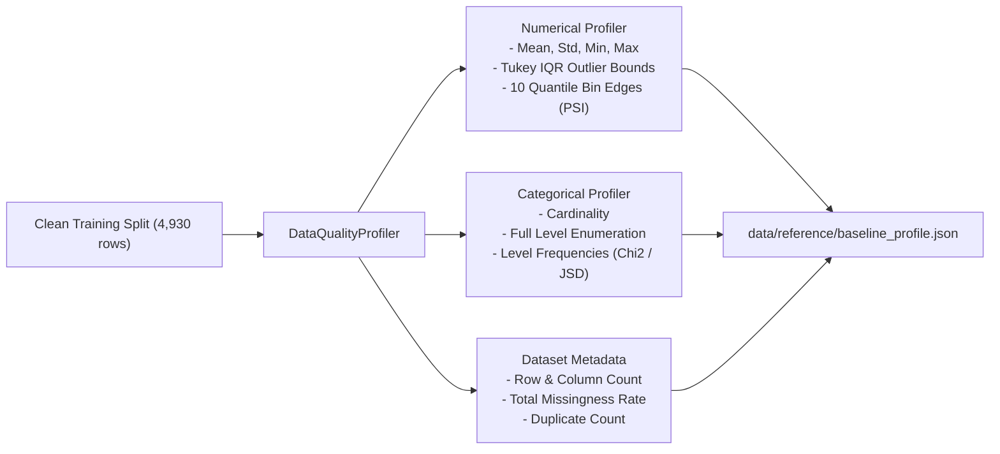

# Step 1: Data Ingestion, Quality Profiling & Preprocessing Pipeline
## Technical Specification & Methodology

This document details the data engineering foundation of the framework: automated ingestion, schema validation, data quality profiling, baseline reference generation, and preprocessing pipelines.

---

### 1. Workload Framing & Dataset Specification

The framework targets the **Telco Customer Churn** workload (7,043 customer records, 20 attributes).

#### Schema Definitions

| Column Name | Type | Storage / Encoding | Statistical Role | Description |
| :--- | :--- | :--- | :--- | :--- |
| `customerID` | String | Dropped | Identifier | Arbitrary customer identifier (dropped to prevent leakage). |
| `tenure` | Integer | Continuous Float | Numerical Predictor | Number of months the customer has stayed with the company ($[0, 72]$). |
| `MonthlyCharges` | Float | Continuous Float | Numerical Predictor | Monthly recurring fee charged ($[18.25, 118.75]$). |
| `TotalCharges` | Float | Continuous Float | Numerical Predictor | Cumulative lifetime charges billed ($[18.80, 8684.80]$). |
| `SeniorCitizen` | Binary Int | Categorical String | Categorical Predictor | Whether customer is $\ge 65$ years old (0 or 1). |
| Categorical ($15$ features) | Nominal String | One-Hot Encoded | Categorical Predictor | `gender`, `Partner`, `Dependents`, `PhoneService`, `MultipleLines`, `InternetService`, `OnlineSecurity`, `OnlineBackup`, `DeviceProtection`, `TechSupport`, `StreamingTV`, `StreamingMovies`, `Contract`, `PaperlessBilling`, `PaymentMethod`. |
| `Churn` | Binary String | Target (1/0) | Binary Target Label | Churn status: `'Yes'` (1) or `'No'` (0). Prevalence: $26.54\%$. |

---

### 2. Ingestion & Schema Cleaning Methodology
* **Implementation:** [`src/data/ingestion.py`](file:///c:/Josh/practice/data_analytics/src/data/ingestion.py)

#### Algorithmic Ingestion Workflow
1. **Network Ingestion & Caching:** Dataset is fetched from the canonical IBM Telco Churn repository and cached locally at `data/raw/telco_churn.csv`.
2. **Type Coercion for Whitespace Entries:** The raw `TotalCharges` column contains 11 records with blank whitespace strings (`' '`) representing customers with `tenure == 0`. Standard parsers treat these as `object` strings. The pipeline coerces them to `float` and imputes them with `0.0`:
   $$\text{TotalCharges}_i = \begin{cases} \text{float}(v_i), & \text{if } v_i \neq \text{' '} \\ 0.0, & \text{if } v_i = \text{' '} \end{cases}$$
3. **Target Binary Mapping:**
   $$Y_i = \mathbb{I}(\text{Churn}_i = \text{'Yes'}) \in \{0, 1\}$$
4. **Identifier Elimination:** `customerID` is stripped to ensure zero spurious correlation with target labels.

---

### 3. Stratified Splitting & Partition Locking

To eliminate data snooping and target leakage, the cleaned dataset is split into three strictly isolated partitions:

$$\mathcal{D} = \mathcal{D}_{\text{train}} \cup \mathcal{D}_{\text{val}} \cup \mathcal{D}_{\text{test}}$$

#### Partition Proportions & Properties

| Split | Ratio | Sample Size ($N$) | Churn Prevalence $P(Y=1)$ | Purpose |
| :--- | :---: | :---: | :---: | :--- |
| **Train Split ($\mathcal{D}_{\text{train}}$)** | $70\%$ | $4,930$ | $0.2653$ ($26.5\%$) | Model parameter training and baseline reference statistical profile generation. |
| **Validation Split ($\mathcal{D}_{\text{val}}$)** | $15\%$ | $1,056$ | $0.2652$ ($26.5\%$) | Hyperparameter tuning and threshold calibration. |
| **Pristine Test Split ($\mathcal{D}_{\text{test}}$ / $T_0$)** | $15\%$ | $1,057$ | $0.2658$ ($26.6\%$) | Immutable clean baseline evaluation benchmark. |

#### Stratification Formula
For each partition $k \in \{\text{train}, \text{val}, \text{test}\}$, stratification ensures:

$$\left| \frac{\sum_{i \in \mathcal{D}_k} Y_i}{|\mathcal{D}_k|} - \frac{\sum_{i \in \mathcal{D}} Y_i}{|\mathcal{D}|} \right| < 10^{-4}$$

---

### 4. Data Quality Profiling & Baseline Reference Engine
* **Implementation:** [`src/quality/profiler.py`](file:///c:/Josh/practice/data_analytics/src/quality/profiler.py)
* **Output Artifact:** [`data/reference/baseline_profile.json`](file:///c:/Josh/practice/data_analytics/data/reference/baseline_profile.json)

The profiler processes the clean training split $\mathcal{D}_{\text{train}}$ to build an immutable reference profile:



#### A. Numerical Feature Profiling
For continuous feature $X_j \in \mathbb{R}^N$:
1. **Summary Statistics:** Mean ($\mu_j$), Standard Deviation ($\sigma_j$), Median ($\tilde{x}_j$), Minimum ($x_{\min}$), Maximum ($x_{\max}$).
2. **Tukey's IQR Outlier Fences:**
   $$\text{IQR}_j = Q_3(X_j) - Q_1(X_j)$$
   $$\text{Lower Fence}_j = Q_1(X_j) - 1.5 \cdot \text{IQR}_j, \quad \text{Upper Fence}_j = Q_3(X_j) + 1.5 \cdot \text{IQR}_j$$
   $$\text{Outlier Rate}_j = \frac{1}{N} \sum_{i=1}^{N} \mathbb{I}\left( x_{ij} < \text{Lower Fence}_j \lor x_{ij} > \text{Upper Fence}_j \right)$$
3. **Quantile Bin Edge Locking:**
   Computes 10 equal-frequency quantile thresholds:
   $$b_k = \text{Percentile}\left(X_j, \frac{k}{10} \times 100\right), \quad k \in \{0, 1, \dots, 10\}$$
   *Why Freeze Bin Edges?* Pre-computing and saving $\{b_0, \dots, b_{10}\}$ guarantees that downstream Population Stability Index (PSI) calculations on production batches partition data into identical buckets, preventing bin boundary drift.

#### B. Categorical Feature Profiling
For categorical feature $C_k$ with support $\mathcal{C}_k = \{c_1, c_2, \dots, c_K\}$:
1. **Cardinality:** $|\mathcal{C}_k|$
2. **Frequency Distribution:**
   $$P(C_k = c) = \frac{1}{N} \sum_{i=1}^{N} \mathbb{I}(c_{ik} = c)$$
   Stored as key-value pairs for downstream Chi-Square and Jensen-Shannon Divergence computations.

#### C. Production Defect Detection Rules
When evaluating a production batch $\mathcal{B}_{\text{prod}}$ against the reference baseline profile:
- **Missingness Surge:** Flagged if $\text{MissingRate}_{\text{prod}}(X_j) - \text{MissingRate}_{\text{base}}(X_j) \ge 0.05$ (5% absolute spike).
- **Novel Unseen Categories:** Flagged if $\exists c \in \mathcal{C}_{\text{prod}}$ such that $c \notin \mathcal{C}_{\text{base}}$ (excluding `'nan'`).
- **Outlier Explosion:** Flagged if $\text{OutlierRate}_{\text{prod}}(X_j) - \text{OutlierRate}_{\text{base}}(X_j) \ge 0.10$ (10% surge).

---

### 5. Feature Preprocessing Pipeline
* **Implementation:** [`src/data/preprocessor.py`](file:///c:/Josh/practice/data_analytics/src/data/preprocessor.py)
* **Output Artifact:** [`data/reference/preprocessor.joblib`](file:///c:/Josh/practice/data_analytics/data/reference/preprocessor.joblib)

#### Pipeline Transformation Architecture
The pipeline encapsulates a Scikit-Learn `ColumnTransformer`:

$$\mathbf{x} \in \mathbb{R}^{19} \xrightarrow{\quad \Phi(\mathbf{x}) \quad} \mathbf{z} \in \mathbb{R}^{46}$$

1. **Numerical Stream (3 features: `tenure`, `MonthlyCharges`, `TotalCharges`):**
   - **Imputer:** `SimpleImputer(strategy="median")`
     $$\hat{x}_{ij} = \text{median}(X_j) \quad \text{if } x_{ij} \text{ is missing}$$
   - **Scaler:** `StandardScaler()`
     $$z_{ij} = \frac{\hat{x}_{ij} - \mu_j}{\sigma_j}$$
2. **Categorical Stream (16 features):**
   - **Imputer:** `SimpleImputer(strategy="most_frequent")`
   - **Encoder:** `OneHotEncoder(handle_unknown="ignore", sparse_output=False)`
     Maps categorical levels into 43 binary indicator columns:
     $$z_{ik} = \mathbb{I}(c_i = \text{level}_k)$$
   - *Production Resilience Trade-off:* `handle_unknown="ignore"` ensures that if an unseen categorical level appears in production, it is mapped to an all-zero vector rather than throwing an exception and halting inference.

---

### 6. Verification & Execution

To test data ingestion, profiling, and preprocessing independently:

```bash
# Execute ingestion and splitting
uv run .\src\data\ingestion.py

# Generate baseline statistical profile
uv run .\src\quality\profiler.py

# Fit and serialize preprocessing pipeline
uv run .\src\data\preprocessor.py
```
