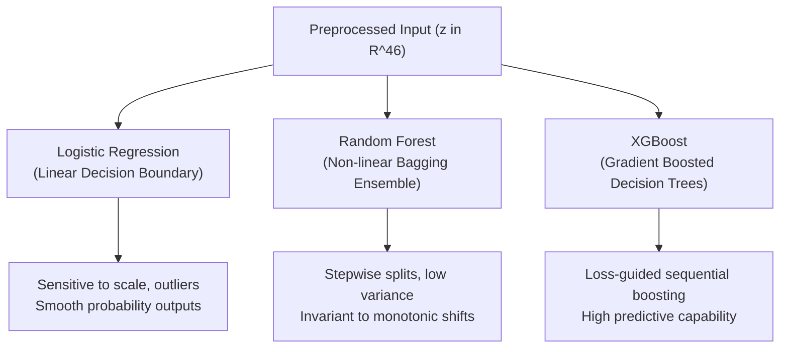

# Step 2: Baseline Modeling, Evaluation Metrics & SHAP Attribution
## Technical Specification & Methodology

This document details the machine learning foundation of the framework: the three baseline estimator architectures, the multi-metric evaluation suite, and the game-theoretic SHAP feature importance extraction pipeline.

---

### 1. Estimator Architectures & Mathematical Formulations
* **Implementation:** [`src/models/train.py`](file:///c:/Josh/practice/data_analytics/src/models/train.py)
* **Configuration:** [`configs/model_config.yaml`](file:///c:/Josh/practice/data_analytics/configs/model_config.yaml)

To ensure that findings are not artifacts of a single modeling paradigm, we evaluate three fundamentally distinct estimator families:



#### A. Logistic Regression (Linear Benchmark)
Models the log-odds of churn as a linear combination of preprocessed features $\mathbf{z}$:

$$P(Y=1 \mid \mathbf{z}) = \sigma(\mathbf{w}^T \mathbf{z} + b) = \frac{1}{1 + e^{-(\mathbf{w}^T \mathbf{z} + b)}}$$

Trained with L2 (Ridge) regularization to prevent overfitting on collinear features:

$$\min_{\mathbf{w}, b} \left\{ - \frac{1}{N} \sum_{i=1}^{N} \left[ y_i \ln \sigma(\mathbf{w}^T \mathbf{z}_i + b) + (1 - y_i) \ln(1 - \sigma(\mathbf{w}^T \mathbf{z}_i + b)) \right] + \frac{1}{2C} \|\mathbf{w}\|_2^2 \right\}$$

*Hyperparameters:* $C = 1.0$, `solver="lbfgs"`, `max_iter=1000`.

#### B. Random Forest (Non-Linear Bagging Benchmark)
An ensemble of $B = 150$ de-correlated decision trees trained via bootstrap aggregation (bagging) with random feature subspace sampling:

$$\hat{P}(Y=1 \mid \mathbf{z}) = \frac{1}{B} \sum_{b=1}^{B} T_b(\mathbf{z})$$

Each tree split node minimizes Gini impurity:

$$I_G(S) = 1 - \sum_{k \in \{0, 1\}} p_k^2$$

$$\Delta I_G = I_G(S) - \left( \frac{|S_L|}{|S|} I_G(S_L) + \frac{|S_R|}{|S|} I_G(S_R) \right)$$

*Hyperparameters:* $n_{\text{estimators}} = 150$, $\text{max\_depth} = 8$, $\text{min\_samples\_split} = 5$, $\text{min\_samples\_leaf} = 2$.

#### C. XGBoost (Gradient Boosted Decision Trees Benchmark)
Constructs an additive ensemble of $K = 150$ regression trees in functional space using second-order Taylor expansions:

$$\hat{y}_i^{(t)} = \hat{y}_i^{(t-1)} + f_t(\mathbf{z}_i)$$

Objective function at step $t$:

$$\mathcal{L}^{(t)} \approx \sum_{i=1}^{N} \left[ l(y_i, \hat{y}_i^{(t-1)}) + g_i f_t(\mathbf{z}_i) + \frac{1}{2} h_i f_t^2(\mathbf{z}_i) \right] + \Omega(f_t)$$

where:
- Gradient: $g_i = \partial_{\hat{y}^{(t-1)}} l(y_i, \hat{y}^{(t-1)}) = \hat{p}_i - y_i$
- Hessian: $h_i = \partial^2_{\hat{y}^{(t-1)}} l(y_i, \hat{y}^{(t-1)}) = \hat{p}_i (1 - \hat{p}_i)$
- Tree Complexity Penalty: $\Omega(f_t) = \gamma T + \frac{1}{2} \lambda \sum_{j=1}^{T} w_j^2$

The optimal leaf weight for leaf $j$ with instance set $I_j$ is given analytically:

$$w_j^* = - \frac{\sum_{i \in I_j} g_i}{\sum_{i \in I_j} h_i + \lambda}$$

*Hyperparameters:* $n_{\text{estimators}} = 150$, $\text{max\_depth} = 5$, $\eta = 0.05$, $\text{subsample} = 0.8$, $\text{colsample\_bytree} = 0.8$.

---

### 2. Multi-Metric Evaluation Suite
* **Implementation:** [`src/models/evaluate.py`](file:///c:/Josh/practice/data_analytics/src/models/evaluate.py)

Because tabular churn problems present class imbalance (~26.5% churn rate), relying solely on accuracy produces misleading results. The evaluation suite computes six complementary performance and calibration metrics:

#### A. Macro-$F_1$ Score (Primary Performance Metric)
Computes the unweighted harmonic mean of Precision and Recall across both classes, treating minority churners and majority non-churners with equal importance:

$$\text{Macro-}F_1 = \frac{1}{2} \left[ F_1^{(0)} + F_1^{(1)} \right] = \frac{1}{2} \left[ \frac{2 P_0 R_0}{P_0 + R_0} + \frac{2 P_1 R_1}{P_1 + R_1} \right]$$

#### B. Receiver Operating Characteristic Area Under Curve (ROC-AUC)
Integrates True Positive Rate against False Positive Rate across all probability thresholds $\tau \in [0, 1]$:

$$\text{ROC-AUC} = \int_{0}^{1} \text{TPR}(\tau) \, d(\text{FPR}(\tau))$$

Equivalently, it is the Wilcoxon-Mann-Whitney probability that a randomly chosen churner receives a higher model score than a non-churner:

$$\text{ROC-AUC} = P(\hat{p}(x^+) > \hat{p}(x^-))$$

#### C. Precision-Recall Area Under Curve (PR-AUC)
Summarizes the trade-off between Precision and Recall for the minority class:

$$\text{PR-AUC} = \sum_{n} (R_n - R_{n-1}) P_n$$

#### D. Brier Score Loss (Calibration Quality)
Measures the mean squared difference between predicted class probabilities $\hat{p}_i$ and actual binary outcomes $y_i \in \{0, 1\}$:

$$\text{Brier} = \frac{1}{N} \sum_{i=1}^{N} (y_i - \hat{p}_i)^2 \in [0, 1]$$

A lower Brier score indicates better probability calibration.

#### E. Degradation Metrics
When evaluating a production batch $\mathcal{B}_{\text{prod}}$ against the clean baseline $T_0$:

$$\text{Absolute Degradation } \Delta M = M(T_0) - M(\mathcal{B}_{\text{prod}})$$

$$\text{Relative Percentage Degradation } \% \Delta M = \frac{M(T_0) - M(\mathcal{B}_{\text{prod}})}{M(T_0)} \times 100\%$$

---

### 3. Pristine Baseline Benchmark Results

Trained on $\mathcal{D}_{\text{train}}$ ($4,930$ samples) and evaluated on the pristine baseline test set $T_0$ ($1,057$ samples):

| Estimator Family | ROC-AUC | PR-AUC | Macro-$F_1$ | Binary-$F_1$ | Precision | Recall | Accuracy | Brier Score |
| :--- | :---: | :---: | :---: | :---: | :---: | :---: | :---: | :---: |
| **Logistic Regression** | **0.8448** | 0.6580 | **0.7366** | 0.6015 | 0.6723 | 0.5445 | **0.8108** | **0.1348** |
| **Random Forest** | 0.8383 | **0.6707** | 0.7080 | 0.5516 | 0.6685 | 0.4698 | 0.7947 | 0.1374 |
| **XGBoost** | 0.8363 | 0.6568 | 0.7017 | 0.5413 | 0.6480 | 0.4662 | 0.7890 | 0.1408 |

All metrics are locked in [`data/reference/baseline_metrics.json`](file:///c:/Josh/practice/data_analytics/data/reference/baseline_metrics.json).

---

### 4. SHAP Feature Attribution Theory & Aggregation
* **Implementation:** [`src/models/importance.py`](file:///c:/Josh/practice/data_analytics/src/models/importance.py)
* **Output Artifact:** [`data/reference/feature_importance.json`](file:///c:/Josh/practice/data_analytics/data/reference/feature_importance.json)

#### A. Shapley Additive exPlanations Formulation
Shapley values allocate credit for a model prediction $f(\mathbf{z})$ across input features based on cooperative game theory. The attribution $\phi_j$ for feature $j$ satisfies efficiency, symmetry, dummy player, and additivity:

$$\phi_j(f, \mathbf{z}) = \sum_{S \subseteq \mathcal{F} \setminus \{j\}} \frac{|S|!(|\mathcal{F}| - |S| - 1)!}{|\mathcal{F}|!} \left[ f_x(S \cup \{j\}) - f_x(S) \right]$$

Global importance is quantified as the mean absolute SHAP attribution across the sample population:

$$I_j = \frac{1}{N_{\text{sample}}} \sum_{i=1}^{N_{\text{sample}}} |\phi_j(f, \mathbf{z}_i)|$$

#### B. Dummy-to-Raw Feature Aggregation
Preprocessed inputs $\mathbf{z} \in \mathbb{R}^{46}$ contain one-hot indicator columns for categorical variables. However, operational monitoring occurs on *raw input columns*. To compute the true attribution of raw categorical feature $C_k$:

$$I_{\text{raw}}(C_k) = \sum_{j \in \text{EncodedLevels}(C_k)} I_j$$

For continuous features (e.g., `tenure`, `MonthlyCharges`), $I_{\text{raw}}(X_j) = I_j$.

All raw feature scores are normalized to sum to $1.0$:

$$\text{Weight}(F_k) = \frac{I_{\text{raw}}(F_k)}{\sum_{m=1}^{P} I_{\text{raw}}(F_m)}$$

#### C. Consensus Feature Rankings Across Estimators

$$\text{Consensus}(F_k) = \frac{1}{3} \left[ \text{Weight}_{\text{XGB}}(F_k) + \text{Weight}_{\text{RF}}(F_k) + \text{Weight}_{\text{LR}}(F_k) \right]$$

```
Rank  Raw Feature Name        Consensus Weight   Cumulative Share
------------------------------------------------------------------
#01   Contract                     18.32%             18.32%
#02   tenure                       13.11%             31.43%
#03   InternetService               8.50%             39.93%
#04   TotalCharges                  7.54%             47.47%
#05   OnlineSecurity                7.35%             54.82%
#06   MonthlyCharges                6.63%             61.45%
#07   PaymentMethod                 6.29%             67.74%
#08   TechSupport                   5.97%             73.71%
#09   StreamingMovies               3.53%             77.24%
#10   PaperlessBilling              3.48%             80.72%
------------------------------------------------------------------
Bottom Features (gender, PhoneService, Partner, Dependents) < 2.5% each
```

*Key Insight:* The top 8 features account for nearly $75\%$ of all model decision weight. Consequently, drift in `Contract` or `tenure` represents a critical operational risk, whereas drift in `gender` or `PhoneService` will have negligible effect on decision boundaries.

---

### 5. Verification & Execution

To re-train the models and extract SHAP consensus importance:

```bash
# Train all three baseline estimators
uv run .\src\models\train.py

# Extract and persist SHAP consensus rankings
uv run .\src\models\importance.py
```
