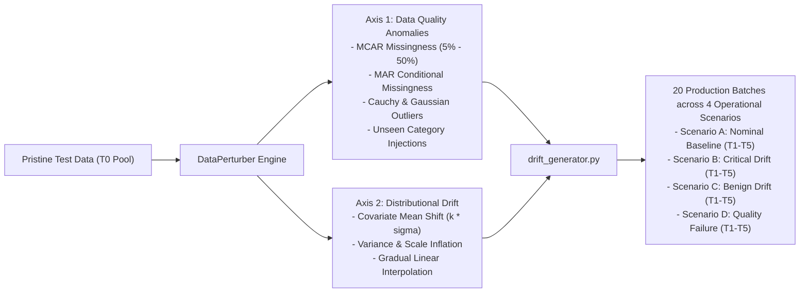

# Step 3: Controlled Perturbation & Production Simulation
## Technical Specification & Methodology

This document details the synthetic perturbation engines and production simulation harness used to stress-test ML estimators under controlled data quality anomalies and distributional drift.

---

### 1. Research Motivation for Controlled Synthetic Perturbation

Real-world production ML pipelines rarely experience well-behaved, isolated failures. Instead, they face unpredictable combinations of upstream data pipeline defects (e.g., schema changes, database migrations) and real-world population drift (e.g., socioeconomic shifts, competitor promotions).

To isolate the causal relationship between specific data defects and downstream model degradation, we implement a **parameter-controlled perturbation engine**:
1. It systematically controls the defect type, feature target, and corruption intensity.
2. It allows direct comparison between drift in **high-importance features** versus identical drift in **low-importance features**.



---

### 2. Mathematical Formulations: Data Quality Mutations
* **Implementation:** [`src/simulation/perturbation.py`](file:///c:/Josh/practice/data_analytics/src/simulation/perturbation.py)

#### A. Missing Completely At Random (MCAR)
Missingness occurs independently of both observed and unobserved data:

$$P(M_{ij} = 1 \mid \mathbf{x}_i, y_i) = \alpha, \quad \alpha \in [0.05, 0.50]$$

where $M_{ij} = 1$ indicates that feature $j$ of instance $i$ is set to `NaN`:

$$x_{ij} \leftarrow \begin{cases} \text{NaN}, & \text{if } U_{ij} < \alpha, \quad U_{ij} \sim \text{Uniform}(0, 1) \\ x_{ij}, & \text{otherwise} \end{cases}$$

#### B. Missing At Random (MAR)
Missingness in target feature $X_j$ is conditionally dependent on the observed values of another feature $X_k$:

$$P(M_{ij} = 1 \mid X_{ik} \ge q_\theta) = \alpha_{\text{cond}}$$

$$P(M_{ij} = 1 \mid X_{ik} < q_\theta) = 0$$

where $q_\theta$ is the $\theta$-quantile of conditioning feature $X_k$.
*Example:* Missingness in `TotalCharges` occurs primarily for customers with high `MonthlyCharges` ($\theta = 0.50$).

#### C. Outlier Contamination Modes
For a continuous feature $X_j \sim (\mu_j, \sigma_j^2)$ with a contamination fraction $\delta \in [0.05, 0.20]$:

1. **Additive Gaussian Shift Noise:**
   $$x_{ij}' = x_{ij} + \mathcal{N}(k \cdot \sigma_j, \sigma_j^2), \quad k \in [2.0, 5.0]$$
2. **Heavy-Tailed Cauchy Noise:**
   The Cauchy distribution $\text{Cauchy}(x_0=0, \gamma)$ has undefined mean and infinite variance, generating extreme, heavy-tailed anomalies:
   $$x_{ij}' = x_{ij} + \gamma \cdot \sigma_j \cdot \tan\left( \pi \left( U - \frac{1}{2} \right) \right), \quad U \sim \text{Uniform}(0, 1)$$
3. **Scale Multiplier:**
   Multiplies selected continuous observations by an extreme scale factor $\gamma \in [2.0, 10.0]$:
   $$x_{ij}' = \gamma \cdot x_{ij}$$

#### D. Categorical Level Corruption & Novel Tokens
Substitutes known categories with unseen tokens at corruption rate $\beta \in [0.05, 0.30]$:

$$c_{ik}' = \begin{cases} \text{'NEW\_FLEX\_PLAN\_v9'}, & \text{if } U_i < \beta \\ c_{ik}, & \text{otherwise} \end{cases}$$

*Downstream Impact:* Tests whether preprocessing encoders fail gracefully and whether tree split partitions misroute novel categories.

---

### 3. Mathematical Formulations: Distributional Drift

#### A. Sudden Covariate Mean Shift
Shifts the distribution mean by $k$ standard deviations while preserving the shape and variance:

$$X_j' = X_j + k \cdot \sigma_j, \quad k \in [0.5, 3.5]$$

$$\mathbb{E}[X_j'] = \mu_j + k \cdot \sigma_j, \quad \text{Var}(X_j') = \text{Var}(X_j)$$

#### B. Variance / Scale Inflation
Increases distribution dispersion around the mean without shifting the central tendency:

$$X_j' = \mu_j + \tau \cdot (X_j - \mu_j), \quad \tau \in [1.5, 5.0]$$

$$\mathbb{E}[X_j'] = \mu_j, \quad \text{Var}(X_j') = \tau^2 \cdot \sigma_j^2$$

#### C. Gradual Temporal Covariate Drift
Simulates a non-stationary production environment over $T$ production batches by linearly interpolating between the reference distribution $\mathcal{D}_0$ and shifted distribution $\mathcal{D}_1$:

$$\mathcal{D}(t) = (1 - \lambda_t)\mathcal{D}_0 + \lambda_t \mathcal{D}_1, \quad \lambda_t = \frac{t}{T}, \quad t \in \{1, \dots, T\}$$

---

### 4. Multi-Batch Production Scenarios
* **Implementation:** [`src/simulation/drift_generator.py`](file:///c:/Josh/practice/data_analytics/src/simulation/drift_generator.py)
* **Output Artifacts:** [`data/simulations/`](file:///c:/Josh/practice/data_analytics/data/simulations/)

The generator bootstraps from pristine test data to produce 20 temporal batches (500 instances each) across four scenarios:

```
data/simulations/
├── nominal/
│   ├── Batch_T1_Nominal.csv ... Batch_T5_Nominal.csv
├── critical_drift/
│   ├── Batch_T1_CriticalDrift.csv ... Batch_T5_CriticalDrift.csv
├── benign_drift/
│   ├── Batch_T1_BenignDrift.csv ... Batch_T5_BenignDrift.csv
└── quality_failure/
    ├── Batch_T1_QualityFailure.csv ... Batch_T5_QualityFailure.csv
```

#### Scenario Specifications

| Scenario Name | Targeted Features | Targeted Feature Importance | Mutation Injected | Expected Downstream Impact | Expected Triage Level |
| :--- | :--- | :---: | :--- | :--- | :---: |
| **Scenario A: Nominal Operations** | None (Clean sampling) | N/A | None (Natural statistical variance) | $\Delta F_1 < 1.0\%$ | **P4: Nominal** |
| **Scenario B: Critical Drift** | `Contract`, `tenure`, `MonthlyCharges` | **Top #1, #2, #6 (38.1% combined)** | Progressive mean shift ($0.7\sigma - 2.8\sigma$) + novel contract tokens | Severe collapse: $\Delta F_1 > 12\%$ | **P1: Critical Breach** |
| **Scenario C: Benign Drift** | `gender`, `PhoneService`, `MultipleLines` | **Bottom features (< 3.0% combined)** | Extreme category substitution ($20\% - 60\%$ novel tokens) | Negligible: $\Delta F_1 < 1.5\%$ | **P3: Benign Drift** (Suppressed) |
| **Scenario D: Quality Failure** | `TotalCharges`, `tenure`, `MonthlyCharges` | Top #4, #2, #6 | Surging MCAR missingness ($10\% - 40\%$) + 5x outlier explosion | Moderate to High: $\Delta F_1 \ge 4\%$ | **P2: Quality Alert** |

---

### 5. Verification & Execution

To re-synthesize all scenario batches:

```bash
uv run .\src\simulation\drift_generator.py
```
