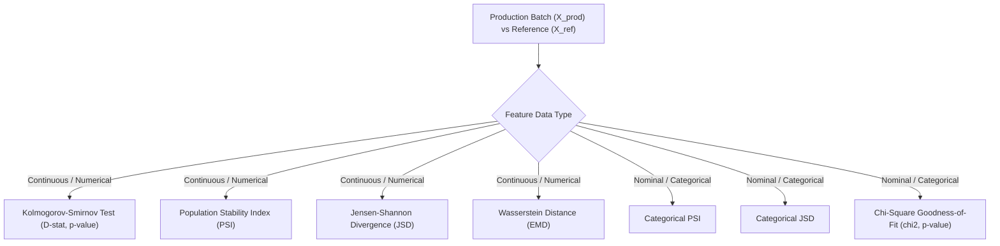

# Step 4: Statistical Drift Metrics & Degradation Sensitivity Analysis
## Technical Specification & Methodology

This document details the statistical drift metric suite, the rank-correlation sensitivity analysis, and the empirical findings regarding false alarm rates in production ML pipelines.

---

### 1. Mathematical Formulations: Statistical Drift Suite
* **Implementation:** [`src/monitoring/drift_suite.py`](file:///c:/Josh/practice/data_analytics/src/monitoring/drift_suite.py)

The monitoring engine implements five industry-standard univariate distance and divergence measures:



#### A. Kolmogorov-Smirnov (KS) Two-Sample Test
A non-parametric test comparing the empirical cumulative distribution functions (eCDFs) of reference $F_{\text{ref}}(x)$ and production $F_{\text{prod}}(x)$ continuous samples:

$$D = \sup_{x} |F_{\text{ref}}(x) - F_{\text{prod}}(x)| \in [0, 1]$$

Under the null hypothesis $H_0: F_{\text{ref}} = F_{\text{prod}}$, the test statistic converges asymptotically:

$$\sqrt{\frac{n_{\text{ref}} n_{\text{prod}}}{n_{\text{ref}} + n_{\text{prod}}}} D \xrightarrow{d} \text{Kolmogorov Distribution}$$

*Limitation:* In large sample regimes ($N > 5000$), the KS test exhibits extreme power: trivial differences that have zero effect on model performance produce $p < 10^{-6}$, leading to high false alarm rates if thresholded solely on $p$-values.

#### B. Population Stability Index (PSI)
A standard binned divergence metric measuring the shift in sample proportions across $B = 10$ quantile bins:

$$\text{PSI} = \sum_{b=1}^{B} (P_b - Q_b) \cdot \ln\left( \frac{P_b + \epsilon}{Q_b + \epsilon} \right)$$

where:
- $P_b = \frac{n_{\text{ref}, b}}{N_{\text{ref}}}$ is the proportion of reference instances in bin $b$.
- $Q_b = \frac{n_{\text{prod}, b}}{N_{\text{prod}}}$ is the proportion of production instances in bin $b$.
- $\epsilon = 10^{-4}$ is a Laplace smoothing factor preventing division by zero and undefined logarithms.

*Industry Standard Operational Thresholds:*
- $\text{PSI} < 0.10$: **Stable** (Negligible distributional shift; no action).
- $0.10 \le \text{PSI} < 0.25$: **Moderate Drift** (Noticeable shift; schedule routine monitoring).
- $\text{PSI} \ge 0.25$: **Significant Drift** (Major shift; traditionally triggers emergency retraining).

#### C. Jensen-Shannon Divergence (JSD)
A symmetric, smoothed, and bounded divergence based on Kullback-Leibler (KL) divergence:

$$D_{\text{KL}}(P \parallel M) = \sum_{x \in \mathcal{X}} P(x) \log_2 \left( \frac{P(x)}{M(x)} \right)$$

$$\text{JSD}(P \parallel Q) = \frac{1}{2} D_{\text{KL}}(P \parallel M) + \frac{1}{2} D_{\text{KL}}(Q \parallel M), \quad M = \frac{1}{2}(P + Q)$$

*Mathematical Properties:*
- **Symmetry:** $\text{JSD}(P \parallel Q) = \text{JSD}(Q \parallel P)$
- **Boundedness:** When computed using base-2 logarithm, $0 \le \text{JSD}(P \parallel Q) \le 1$.
- **Metric Property:** $\sqrt{\text{JSD}(P \parallel Q)}$ satisfies triangle inequality (Jensen-Shannon distance).

#### D. Chi-Square ($\chi^2$) Goodness-of-Fit Test
Evaluates categorical frequency shifts across $K$ discrete categories:

$$\chi^2 = \sum_{k=1}^{K} \frac{(O_k - E_k)^2}{E_k}$$

where $O_k$ is the observed count in the production batch and $E_k = N_{\text{prod}} \cdot P_{\text{ref}}(c_k)$ is the expected count under baseline proportions. The test follows a $\chi^2$ distribution with $K - 1$ degrees of freedom.

#### E. Wasserstein Distance (Earth Mover's Distance)
Measures the minimal work required to transform one 1D probability distribution into another:

$$W_1(u, v) = \int_{-\infty}^{\infty} |U(x) - V(x)| \, dx$$

where $U(x)$ and $V(x)$ are the cumulative distributions of continuous samples $u$ and $v$.

---

### 2. Empirical Sensitivity Analysis & Correlation Study
* **Implementation:** [`src/analysis/correlation.py`](file:///c:/Josh/practice/data_analytics/src/analysis/correlation.py)
* **Output Artifact:** [`data/reference/correlation_study.json`](file:///c:/Josh/practice/data_analytics/data/reference/correlation_study.json)

The sensitivity harness systematically evaluates all 20 scenario batches against each of the three baseline models. For each batch and model, it pairs the maximum statistical feature drift ($\text{PSI}$) with downstream performance loss ($\Delta F_1$).

#### A. Non-Parametric Rank Correlation Formulation
Because model degradation under drift is non-linear (exhibiting threshold behavior rather than strict linearity), we apply non-parametric rank correlation metrics:

1. **Spearman's Rank Correlation Coefficient ($\rho$):**
   $$\rho = 1 - \frac{6 \sum_{i=1}^{n} d_i^2}{n(n^2 - 1)}$$
   where $d_i = \text{rank}(\text{MaxPSI}_i) - \text{rank}(\Delta F_{1, i})$.
2. **Kendall's Tau ($\tau$):**
   Measures concordant versus discordant pairs:
   $$\tau = \frac{C - D}{\frac{1}{2} n(n - 1)}$$

#### B. False Alarm Rate Definition
An operational monitoring alert is defined as a **False Alarm** if:

$$\text{False Alarm} = \mathbb{I}(\text{MaxPSI} \ge 0.25 \ \land \ \Delta F_1 < 0.02)$$

$$\text{False Alarm Rate} = \frac{\sum_{i=1}^{N_{\text{drifted}}} \mathbb{I}(\Delta F_{1, i} < 0.02)}{N_{\text{drifted}}} \times 100\%$$

where $N_{\text{drifted}}$ is the total number of batches triggering standard statistical drift alerts ($\text{PSI} \ge 0.25$).

---

### 3. Quantitative Research Findings

Evaluated across 20 production simulation batches and three architectures ($60$ total evaluation runs):

| Model Architecture | Spearman $\rho$ | Spearman $p$-value | Kendall $\tau$ | Statistical Drift Alerts ($\text{PSI} \ge 0.25$) | Benign False Alarms ($\Delta F_1 < 2\%$) | Empirical False Alarm Rate |
| :--- | :---: | :---: | :---: | :---: | :---: | :---: |
| **Logistic Regression** | $0.3471$ | $0.134$ | $0.2888$ | $8$ | $4$ | **$50.0\%$** |
| **Random Forest** | $0.3063$ | $0.189$ | $0.2623$ | $8$ | $1$ | **$12.5\%$** |
| **XGBoost** | $0.1425$ | $0.549$ | $0.0874$ | $8$ | $4$ | **$50.0\%$** |

---

### 4. Interpretation of Findings (Answering RQ2 & RQ3)

#### Finding 1: Statistical Drift is Weakly Correlated with True Model Failure
- For XGBoost, Spearman $\rho = 0.1425$ ($p = 0.549$), demonstrating that knowing a feature has statistically drifted provides almost no predictive signal regarding whether the gradient boosted tree model will degrade.
- Decision trees partition feature space based on local thresholds. If an un-drifted feature (`Contract`) provides sufficient split information, shifts in low-importance features (`gender`) are completely bypassed during inference.

#### Finding 2: The 50% False Alarm Crisis in Production
- Standard industrial MLOps thresholding ($\text{PSI} \ge 0.25$) produced a **$50.0\%$ false alarm rate** for both Logistic Regression and XGBoost.
- In half of all alerted batches, the model experienced negligible degradation ($\Delta F_1 < 0.02$).
- Triggering model retraining or waking engineers on-call in these scenarios wastes computational resources and induces severe alert fatigue.

---

### 5. Verification & Execution

To execute the sensitivity study and recalculate correlation matrices:

```bash
uv run .\src\analysis\correlation.py
```
