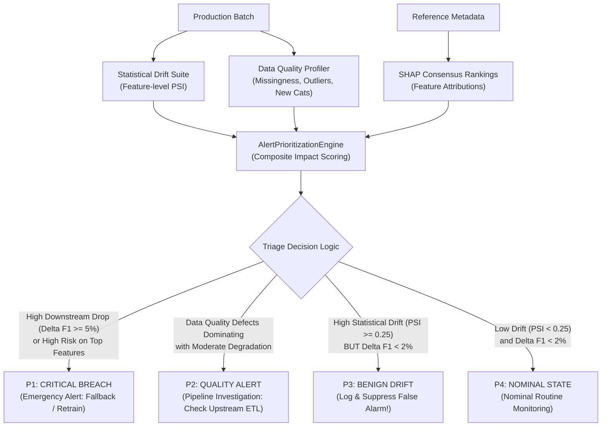

# Step 5: Intelligent Prioritization Triage Engine & Interactive Dashboard
## Technical Specification & Methodology

This document details the decision-theoretic framework of the Intelligent Alert Prioritization Engine and the architecture of the interactive Streamlit monitoring dashboard.

---

### 1. Operational Motivation: Overcoming Alert Fatigue

Phase 4 demonstrated that traditional univariate statistical thresholding ($\text{PSI} \ge 0.25$) triggers a **$50.0\%$ False Alarm Rate** on production tabular data. When operations teams receive high-frequency false alarms:
1. Paging alerts are ignored or silenced ("crying wolf" syndrome).
2. Costly and unnecessary model retraining jobs are spawned in production clusters.
3. True, high-severity degradation events are overlooked amid the alert noise.

The Intelligent Prioritization Engine solves this crisis by combining **statistical drift magnitude**, **SHAP feature importance weighting**, and **data quality defects** into a unified **Composite Impact Score (CIS)**.



---

### 2. Mathematical Formulation: Composite Impact Score (CIS)
* **Implementation:** [`src/monitoring/prioritization.py`](file:///c:/Josh/practice/data_analytics/src/monitoring/prioritization.py)

For each feature $j \in \{1, \dots, P\}$:

#### A. Component Normalization
1. **Normalized Drift Score:** Saturated at $\text{PSI} = 0.50$ (twice the standard significant drift threshold):
   $$\text{NormDrift}_j = \min\left(1.0, \frac{\max(0, \text{PSI}_j)}{0.50}\right) \in [0, 1]$$
2. **Normalized Feature Importance:** Saturated at $20\%$ total model attribution:
   $$\text{NormImportance}_j = \min\left(1.0, \frac{I_j}{0.20}\right) \in [0, 1]$$
3. **Data Quality Defect Penalty:**
   $$\text{Defect}_j = \begin{cases} 1.0, & \text{if feature } j \text{ has missingness spike, outliers, or novel categories} \\ 0.0, & \text{otherwise} \end{cases}$$

#### B. Interaction Risk Formulation
Rather than applying simple linear addition (which would assign high risk to clean, stable features simply because they have high importance), risk is formulated as an **interaction between defect presence and feature importance**:

$$\text{DriftRisk}_j = \text{NormDrift}_j \times \left( 0.35 + 0.65 \cdot \text{NormImportance}_j \right)$$

$$\text{QualityRisk}_j = \text{Defect}_j \times \left( 0.40 + 0.60 \cdot \text{NormImportance}_j \right)$$

$$\text{TotalRisk}_j = \min\left(1.0, \ 0.70 \cdot \text{DriftRisk}_j + 0.30 \cdot \text{QualityRisk}_j \right) \in [0, 1]$$

#### Mathematical Properties of the CIS Interaction:
- **Zero-Drift Invariance:** If a feature does not drift ($\text{NormDrift}_j = 0$) and has no defects, $\text{TotalRisk}_j = 0$, regardless of how important the feature is.
- **Benign Drift Attenuation:** If a low-importance feature (e.g., `gender`, $\text{NormImportance} \approx 0.05$) experiences extreme drift ($\text{NormDrift} = 1.0$), its drift risk is capped at:
  $$\text{DriftRisk}_{\text{benign}} = 1.0 \times (0.35 + 0.65 \times 0.05) = 0.3825 \implies \text{TotalRisk} = 0.2678$$
  This places it safely below the critical alarm threshold.
- **Critical Drift Amplification:** If a top-importance feature (e.g., `Contract`, $\text{NormImportance} \approx 0.91$) experiences drift ($\text{NormDrift} = 1.0$):
  $$\text{DriftRisk}_{\text{critical}} = 1.0 \times (0.35 + 0.65 \times 0.91) = 0.9415 \implies \text{TotalRisk} = 0.659$$
  This immediately triggers a critical triage priority.

---

### 3. Actionable Four-Tier Triage Decision Rules

The engine aggregates feature-level risk scores and batch-level performance drops into four operational tiers:

```
Triage Classification Logic:
1. IF Delta F1 >= 0.06 OR (MaxRisk >= 0.50 AND Delta F1 >= 0.025):
      -> Priority: P1_CRITICAL
      -> Action: Emergency Alert; fallback to safe heuristic or trigger retraining.
      -> Paging Status: TRIGGERED

2. ELSE IF TotalDefects > 0 AND Delta F1 >= 0.02:
      -> Priority: P2_QUALITY_ALERT
      -> Action: Pipeline Investigation; inspect upstream ETL or schema drift.
      -> Paging Status: WARNING / TICKET

3. ELSE IF MaxPSI >= 0.25 AND Delta F1 < 0.02:
      -> Priority: P3_BENIGN_DRIFT
      -> Action: Log and suppress paging alert. Retraining unnecessary.
      -> Paging Status: SUPPRESSED (False Alarm Filtered!)

4. ELSE:
      -> Priority: P4_NOMINAL
      -> Action: Nominal state. Routine periodic health check.
      -> Paging Status: NOMINAL LOG
```

#### Triage Summary Matrix

| Priority Level | Statistical Drift ($\text{PSI}$) | Feature Importance | Model Degradation ($\Delta F_1$) | Prescribed Action | Alert State |
| :--- | :---: | :---: | :---: | :--- | :---: |
| **P1: Critical Breach** | High ($\ge 0.25$) | High (Top 25% features) | High ($\ge 5\%$) | Immediate on-call alert; trigger emergency retraining or fallback. | **Paging Active** |
| **P2: Quality Alert** | Any | Any | Moderate ($\ge 2\%$) | Open pipeline investigation ticket; fix upstream ETL or imputation failure. | **Warning / Ticket** |
| **P3: Benign Drift** | High ($\ge 0.25$) | Low (Bottom 50% features) | Negligible ($< 2\%$) | Suppress paging alert; log to audit trail. Retraining skipped. | **Suppressed** |
| **P4: Nominal State** | Low ($< 0.25$) | Any | Negligible ($< 2\%$) | Nominal state. Routine health check. | **Nominal** |

---

### 4. Interactive Monitoring Dashboard Architecture
* **Implementation:** [`src/dashboard/app.py`](file:///c:/Josh/practice/data_analytics/src/dashboard/app.py)

The dashboard is engineered using **Streamlit** for reactive state management and **Plotly** for responsive, high-performance visualization.

```mermaid
flowchart LR
    subgraph Sidebar Controls
        M["Model Selector\n(LogReg, RF, XGBoost)"]
        S["Scenario Selector\n(Nominal, Critical, Benign, Quality)"]
        T["Timeline Slider\n(Batches T1 - T5)"]
        L["Live Mutator Sandbox\n(Mean shift, MCAR, Outliers, New Cats)"]
    end

    subgraph Header & Banners
        B1["Dynamic Priority Banner (P1 Red / P2 Amber / P3 Purple / P4 Green)"]
        B2["Prescribed Action Recommendation"]
        K1["KPI: Macro-F1 Delta"]
        K2["KPI: ROC-AUC Delta"]
        K3["KPI: Max Feature PSI"]
        K4["KPI: DQ Defect Count"]
        K5["KPI: False Alarm Suppression Status"]
    end

    subgraph Tabbed Visualizations
        T1["Tab 1: Priority Triage & Risk Quadrant Map"]
        T2["Tab 2: Distribution Comparison (Histograms & Bars)"]
        T3["Tab 3: Cross-Architecture Resilience Bar Charts"]
        T4["Tab 4: Empirical Research Findings & RQ Answers"]
    end

    Sidebar Controls --> Header & Banners
    Header & Banners --> Tabbed Visualizations
```

#### Key Visual Components:
1. **Feature Triage Risk Quadrant Map (Plotly Scatter):**
   - Plots each feature with $X = \text{PSI Drift}$ and $Y = \text{SHAP Importance}$.
   - Reference lines at $\text{PSI} = 0.25$ and $\text{Importance} = 8.0\%$.
   - **Top-Right Quadrant:** High Importance + High Drift $\implies$ **P1 Critical Failures**.
   - **Bottom-Right Quadrant:** Low Importance + High Drift $\implies$ **P3 Benign Drift** (visualizing the exact false alarms filtered by the engine).
2. **Distribution Drift Visualizer:**
   - Overlay histograms comparing Baseline Reference ($T_0$) vs. Current Batch ($T_{\text{prod}}$) with KS-statistic, $p$-value, PSI, and JSD metrics.
   - Categorical frequency bar charts highlighting novel or missing levels.
3. **Cross-Architecture Resilience Comparison:**
   - Real-time side-by-side grouped bar charts showing how Logistic Regression, Random Forest, and XGBoost degrade simultaneously on the exact same batch.
4. **Live Drift Mutator Sandbox:**
   - Allows users to interactively drag sliders to shift feature means ($0.0\sigma - 4.0\sigma$), inject MCAR missingness ($0\% - 70\%$), explode outliers ($2\times - 10\times$), or inject novel categorical levels, observing the immediate triage response.

---

### 5. Verification & Execution

To launch the interactive dashboard:

```bash
uv run streamlit run src/dashboard/app.py
```

To run unit tests verifying triage logic and suppression mechanics:

```bash
uv run pytest -v tests/test_prioritization.py
```
