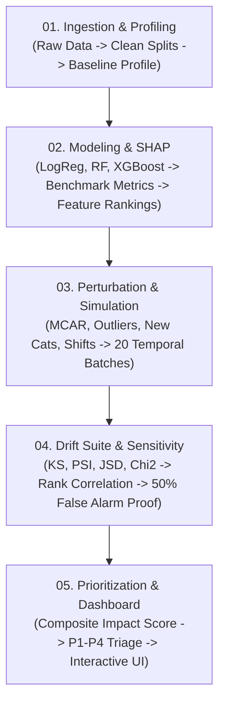

# Comprehensive Technical Documentation & Methodology Suite
## Intelligent Data Quality & Data Drift Monitoring Framework

This directory houses detailed, step-by-step engineering and research documentation for each major phase of the framework. Each document provides thorough mathematical formulations, pseudo-code algorithms, architectural design rationale, and empirical findings.

---

### Documentation Index

| Step / Document | Phase Focus | Key Topics & Mathematical Foundations |
| :--- | :--- | :--- |
| [**01. Data Ingestion & Quality Profiling**](01_data_ingestion_and_profiling.md) | Phase 1: Ingestion & Baseline Reference | Stratified splitting without leakage, Tukey's IQR fences, Quantile binning for PSI, Category frequency distribution, Schema validation. |
| [**02. Baseline Modeling & SHAP Attribution**](02_baseline_modeling_and_shap.md) | Phase 2: ML Engine & Explainability | Tri-model benchmarking (LogReg, RF, XGBoost), Multi-metric evaluation (ROC-AUC, PR-AUC, Macro-$F_1$, Brier score), Shapley values, Dummy-to-raw attribution aggregation. |
| [**03. Controlled Perturbation & Simulation**](03_controlled_perturbation_and_simulation.md) | Phase 3: Stress-Testing & Synthetic Scenarios | MCAR vs MAR missingness models, Cauchy heavy-tailed contamination, Covariate mean shift ($k\sigma$), Variance inflation, Multi-batch temporal synthesis ($T_1 - T_5$). |
| [**04. Statistical Drift & Sensitivity Analysis**](04_statistical_drift_and_sensitivity_analysis.md) | Phase 4: Drift Suite & Degradation Study | Kolmogorov-Smirnov $D$-statistic, Population Stability Index ($\text{PSI}$), Jensen-Shannon Divergence ($\text{JSD}$), $\chi^2$ test, Spearman $\rho$, Kendall $\tau$, 50% False Alarm Rate proof. |
| [**05. Intelligent Prioritization & Dashboard**](05_intelligent_prioritization_and_dashboard.md) | Phase 5: Triage Matrix & Interactive UI | Composite Impact Score (CIS) interaction formula, Four-tier triage matrix (P1 Critical to P4 Benign), False alarm suppression mechanics, Streamlit + Plotly UI. |

---

### Module & Folder-Wise Technical Documentation

For deep dives into individual code packages, modules, classes, and parameter setups:

- 🔬 [**`src/simulation/` Deep Dive Guide**](folder_readmes/simulation.md): Exhaustive technical specification of `DataPerturber`, `ProductionDriftSimulator`, mathematical anomaly formulas, and the 20-batch temporal progression.

---

### Core Pipeline Architecture

