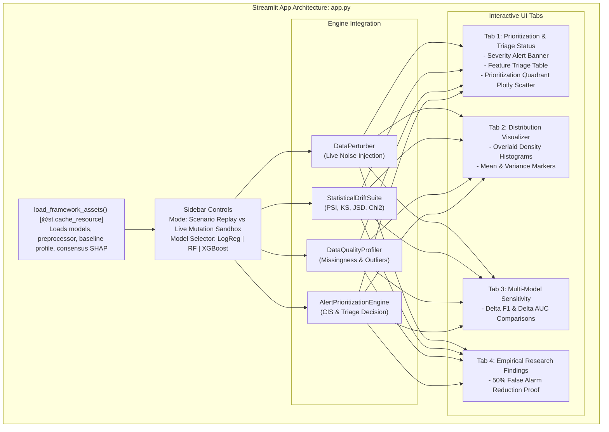

# Module Documentation: `src/dashboard/`
## Interactive Streamlit Web Application & Live Monitoring Sandbox

This document provides an exhaustive technical and architectural specification of the **`src/dashboard/`** module. It explains the application layout, state management, caching strategy, real-time perturbation sandbox, Plotly visualization pipeline, and empirical research interfaces.

---

### 1. Module Overview & Directory Layout

The `src/dashboard/` module houses the interactive web application, serving as the user-facing command center for our intelligent monitoring framework.

```
src/dashboard/
├── __init__.py           # Package initializer
└── app.py                # Full-featured Streamlit application (485 lines)
```

The application connects all framework artifacts into a unified visual interface:
- **Baseline Models:** `models/logistic_regression.joblib`, `models/random_forest.joblib`, `models/xgboost.joblib`
- **Fitted Preprocessor:** `data/reference/preprocessor.joblib`
- **Baseline Profile & Metrics:** `data/reference/baseline_profile.json`, `data/reference/baseline_metrics.json`
- **Consensus Feature Importance:** `data/reference/feature_importance.json`
- **Correlation Study:** `data/reference/correlation_study.json`
- **20 Scenario Batches:** `data/simulations/`

---

### 2. Architectural Design & Philosophy

Monitoring dashboards in enterprise MLOps often suffer from two major deficiencies:
1. **Static Post-Mortem Views:** Most tools only show pre-computed batch metrics after failures occur, lacking interactive "what-if" mutation sandboxes.
2. **Alert Overload:** Without feature importance context, dashboards display dozens of red alarm badges for harmless distribution shifts on low-impact features.

Our Streamlit dashboard solves this by:
- Embedding an **interactive stochastic perturbation sandbox** with real-time sliders for covariate shifts, missingness rates, and novel categories.
- Dynamically calculating the **Composite Impact Score (CIS)** and displaying the **4-Tier Triage Status (P1 to P4)**.
- Highlighting **Suppressed False Alarms** with dedicated explanation banners.



---

### 3. Detailed Technical Deep-Dive: `src/dashboard/app.py`

#### A. High-Performance Caching Architecture (`load_framework_assets`)
Machine learning model binaries and preprocessors are heavy objects. Re-loading them on every Streamlit rerun introduces substantial latency.

We utilize `@st.cache_resource` to cache all reference assets in memory:
```python
@st.cache_resource
def load_framework_assets():
    preprocessor = DataPreprocessor.load(root / "data" / "reference" / "preprocessor.joblib")
    models = {
        "logistic_regression": joblib.load(root / "models" / "logistic_regression.joblib"),
        "random_forest": joblib.load(root / "models" / "random_forest.joblib"),
        "xgboost": joblib.load(root / "models" / "xgboost.joblib"),
    }
    # Return dictionary of assets
```
*Note:* Calling `DataPreprocessor.load()` avoids standard `__main__` unpickling conflicts.

---

#### B. The Interactive Sandbox vs. Scenario Replay Modes

The sidebar allows users to toggle between two operational workflows:

1. **Operational Scenario Replay:**
   - Selects from the 20 pre-synthesized temporal batches across `nominal`, `critical_drift`, `benign_drift`, and `quality_failure`.
   - Allows users to step through time from batch `T1` to `T5` and watch drift evolve longitudinally.

2. **Live Custom Mutation Sandbox:**
   - Gives users real-time sliders to inject controlled defects directly into the pristine test split:
     - **Continuous Covariate Shift (`shift_sigmas`):** `-3.0 sigma` to `+3.0 sigma`.
     - **Variance Scale Multiplier (`scale_factor`):** `0.5x` to `3.0x`.
     - **MCAR Missingness Rate (`missing_rate`):** `0%` to `50%`.
     - **MAR Conditional Missingness Rate (`missing_rate`):** `0%` to `50%` (conditioned on median splits).
     - **Numerical Outlier Multiplier (`scale`):** `0x` to `5x` Cauchy/Gaussian noise.
     - **Novel Unseen Category Injection (`corruption_rate`):** `0%` to `30%` synthetic labels.

---

#### C. Dashboard Visual Components (The 4 Main Tabs)

##### Tab 1: Prioritization & Triage Status
- **Triage Alert Banner:** Dynamically renders color-coded alert banners:
  - `P1_CRITICAL` (Crimson Red): Emergency Retraining Triggered.
  - `P2_QUALITY_ALERT` (Goldenrod): Upstream ETL Pipeline Investigation.
  - `P3_BENIGN_DRIFT` (Amber / Slate): **Alert Suppressed!** Explains that high statistical drift occurred on an unimportant feature, saving engineering resources.
  - `P4_NOMINAL` (Emerald Green): System operating within acceptable statistical limits.
- **Interactive Plotly Prioritization Quadrant:**
  Plots `Max Feature PSI` on the X-axis against downstream `Delta F1` on the Y-axis. The live batch is plotted dynamically inside the quadrant boundaries, proving whether the alert is suppressed or escalated.

##### Tab 2: Distribution Shift Visualizer
- Overlays reference baseline distributions against the live production batch using Plotly density histograms.
- Displays mean discrepancy lines, standard deviation markers, and summary statistics tables.

##### Tab 3: Multi-Model Degradation Sensitivity
- Evaluates the batch simultaneously across Logistic Regression, Random Forest, and XGBoost.
- Renders grouped bar charts displaying `Delta F1`, `Delta ROC-AUC`, `Delta Precision`, and `Delta Recall`, proving the superior resiliency of tree ensembles over linear models.

##### Tab 4: Empirical Research Findings
- Displays empirical false alarm statistics, Spearman rank correlation coefficients (`rho`), and Kendall's `tau`.
- Directly maps findings to project research questions (RQ1: Impact Disparity, RQ2: Diagnostic Validity, RQ3: False Alarm Mitigation).

---

### 4. How to Run Locally

```powershell
# Launch the Streamlit dashboard on localhost:8501
.venv\Scripts\streamlit run src/dashboard/app.py
```

Once running, navigate to:
**http://localhost:8501**
