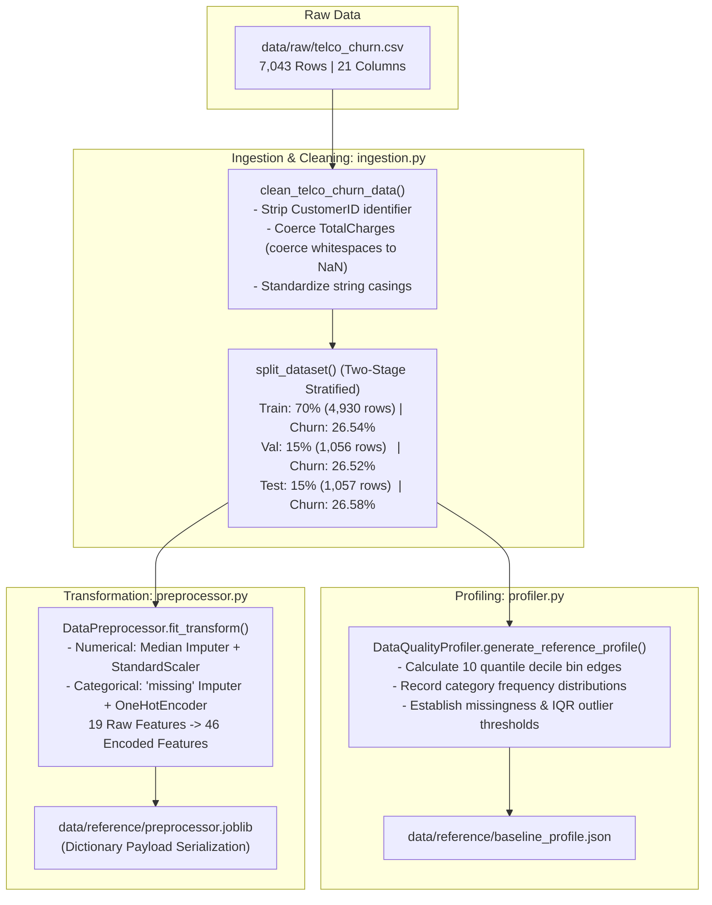

# Module Documentation: `src/data/` & `src/quality/`
## Data Ingestion, Cleaning, Stratified Splitting, Quality Profiling & Preprocessing Pipeline

This document provides an exhaustive technical and mathematical specification of the **`src/data/`** and **`src/quality/`** modules. It explains data cleaning rules, stratified sampling invariance, quantile bin geometry, preprocessing column transformations, and dictionary serialization.

---

### 1. Module Overview & Directory Layout

The data and quality modules form **Phase 1** of our framework, transforming raw, untrusted data into verified, stratified partitions and establishing the reference baseline profiles against which all production drift is measured.

```
src/
├── data/
│   ├── __init__.py           # Package exports
│   ├── ingestion.py          # Data ingestion, schema cleaning, and stratified splitting
│   └── preprocessor.py       # Scikit-Learn ColumnTransformer pipeline (Imputation, Scaling, One-Hot)
└── quality/
    ├── __init__.py           # Package exports
    └── profiler.py           # Baseline profiling, quantile decile locking, and defect detection
```

The modules produce and lock the following physical artifacts:
- **Processed Data Partitions:**
  - `data/processed/train.csv` (4,930 samples, 70% split)
  - `data/processed/val.csv` (1,056 samples, 15% split)
  - `data/processed/test.csv` (1,057 samples, 15% split — pristine benchmark T0)
- **Reference Geometry:** `data/reference/baseline_profile.json`
- **Fitted Preprocessor:** `data/reference/preprocessor.joblib`

---

### 2. Architectural Design & Philosophy

In production ML pipelines, silent failures often originate before a model is ever trained:
1. **Target Distribution Skew:** Non-stratified random splitting can cause class proportions to vary significantly between splits, skewing classification thresholds.
2. **Dynamic Bin Shifting:** If quantile bins for Population Stability Index (PSI) are computed dynamically on production batches, bin boundaries shift over time, rendering drift comparisons mathematically invalid.
3. **Serialization Fragility:** Standard Python pickling of custom classes directly in script entrypoints records the class namespace as `__main__`, causing fatal unpickling crashes in downstream consumers like Streamlit.

Our framework solves these issues by:
- Enforcing **strictly stratified two-stage splitting**.
- Locking **immutable quantile deciles** from pristine training data.
- Decoupling preprocessor serialization via standard **`scikit-learn.compose.ColumnTransformer`** payload dictionaries.



---

### 3. Detailed Technical Deep-Dive: `src/data/ingestion.py`

#### A. Schema Cleaning & Type Coercion (`clean_telco_churn_data`)
1. **Identifier Removal:** The `customerID` column contains high-cardinality unique alphanumeric strings (e.g., `'7590-VHVEG'`) with zero predictive signal. It is dropped to prevent tree models from memorizing IDs.
2. **Whitespace Coercion on `TotalCharges`:** In the raw dataset, 11 new customers with `tenure = 0` have whitespace strings (`" "`) in `TotalCharges`. Standard CSV parsers load these as object strings. We coerce these via:
   ```python
   df["TotalCharges"] = pd.to_numeric(df["TotalCharges"].astype(str).str.strip(), errors="coerce")
   ```
3. **Binary Target Normalization:** The target column `Churn` (`'Yes'` / `'No'`) is mapped to integer values `1` and `0`.

#### B. Two-Stage Stratified Splitting (`split_dataset`)
To achieve an exact 70% / 15% / 15% split while maintaining class balance:
- **Stage 1:** Split full dataset into `Train` (70%) and a temporary buffer `Temp` (30%) stratified on `Churn`.
- **Stage 2:** Split `Temp` equally (50% / 50%) into `Val` (15% of total) and `Test` (15% of total) stratified on `Churn`.

##### Verification of Target Invariance:
```
+---------------+------------+--------------+------------------+
| Partition     | Row Count  | Target Rate  | Class Prevalence |
+---------------+------------+--------------+------------------+
| Train Set     | 4,930 rows | 0.2654       | 26.54% Churn     |
| Val Set       | 1,056 rows | 0.2652       | 26.52% Churn     |
| Test Set (T0) | 1,057 rows | 0.2658       | 26.58% Churn     |
+---------------+------------+--------------+------------------+
```

---

### 4. Detailed Technical Deep-Dive: `src/quality/profiler.py`

The `DataQualityProfiler` establishes the baseline reference geometry locked in `data/reference/baseline_profile.json`.

#### A. Quantile Decile Binning for Continuous Features
To compute Population Stability Index (PSI) longitudinally, the continuous feature space is partitioned into `B = 10` reference decile bins:

```python
quantiles = np.linspace(0, 1, 11)  # 0.0, 0.1, 0.2, ... 1.0
bin_edges = [float(x) for x in np.percentile(series, quantiles * 100)]
bin_edges = sorted(list(set(bin_edges)))
```

##### Locked Decile Boundaries:
- **`tenure` (months):** `[0.0, 2.0, 6.0, 12.0, 20.0, 29.0, 40.0, 50.0, 60.0, 69.0, 72.0]`
- **`MonthlyCharges` (USD):** `[18.25, 20.05, 25.05, 35.50, 49.65, 58.75, 70.35, 79.10, 85.50, 94.40, 118.75]`
- **`TotalCharges` (USD):** `[18.80, 84.60, 269.00, 551.95, 944.75, 1397.48, 2065.40, 3141.75, 4475.90, 5979.30, 8684.80]`

#### B. Categorical Frequency Profiling
For each of the 16 categorical features, the profiler calculates the probability distribution across all unique categories:

```python
frequencies = {str(k): float(v / total) for k, v in series.value_counts(dropna=False).items()}
```

#### C. Statistical Outlier Detection (Tukey's Fences)
Outlier thresholds are locked using the Interquartile Range (IQR):
```
Lower_Bound = Q1 - 1.5 * IQR
Upper_Bound = Q3 + 1.5 * IQR
where IQR = Q3 - Q1
```

---

### 5. Detailed Technical Deep-Dive: `src/data/preprocessor.py`

The `DataPreprocessor` class transforms raw inputs into the standardized 46-dimensional feature space.

#### A. ColumnTransformer Architecture
```python
numerical_pipeline = Pipeline([
    ("imputer", SimpleImputer(strategy="median")),
    ("scaler", StandardScaler()),
])

categorical_pipeline = Pipeline([
    ("imputer", SimpleImputer(strategy="constant", fill_value="missing")),
    ("onehot", OneHotEncoder(handle_unknown="ignore", sparse_output=False)),
])
```

- **Median Imputation:** Robust to extreme skewed values in continuous features (`TotalCharges`).
- **StandardScaler:** Centers continuous features to mean `0.0` and variance `1.0`.
- **One-Hot Encoding:** Expands discrete categories into binary dummy variables. Novel unseen categories in production do not crash inference (`handle_unknown='ignore'`).

#### B. Robust Serialization Architecture (Preventing `__main__` Namespace Bugs)
When a custom Python class is serialized directly via `joblib.dump(self)`, Python records its type as `__main__.DataPreprocessor`. If loaded from another script (like Streamlit), Python looks for `DataPreprocessor` inside that script's namespace and throws `AttributeError: Can't get attribute 'DataPreprocessor'`.

We decoupled persistence by storing only standard library and `scikit-learn` objects:

```python
def save(self, filepath: Path) -> None:
    payload = {
        "pipeline": self.pipeline,
        "feature_names_": self.feature_names_,
        "numerical_features": self.numerical_features,
        "categorical_features": self.categorical_features,
    }
    joblib.dump(payload, filepath)

@classmethod
def load(cls, filepath: Path) -> "DataPreprocessor":
    payload = joblib.load(filepath)
    if isinstance(payload, dict):
        obj = cls(
            numerical_features=payload["numerical_features"],
            categorical_features=payload["categorical_features"],
        )
        obj.pipeline = payload["pipeline"]
        obj.feature_names_ = payload["feature_names_"]
        return obj
    return payload
```

Because `sklearn.compose.ColumnTransformer` belongs to the `sklearn` namespace, it is completely immune to script entrypoint conflicts.

---

### 6. How to Run & Verify

#### Run Data Ingestion & Splitting:
```powershell
uv run .\src\data\ingestion.py
```

#### Run Preprocessor Pipeline & Serialization:
```powershell
uv run .\src\data\preprocessor.py
```

#### Run Baseline Profiling:
```powershell
uv run .\src\quality\profiler.py
```
