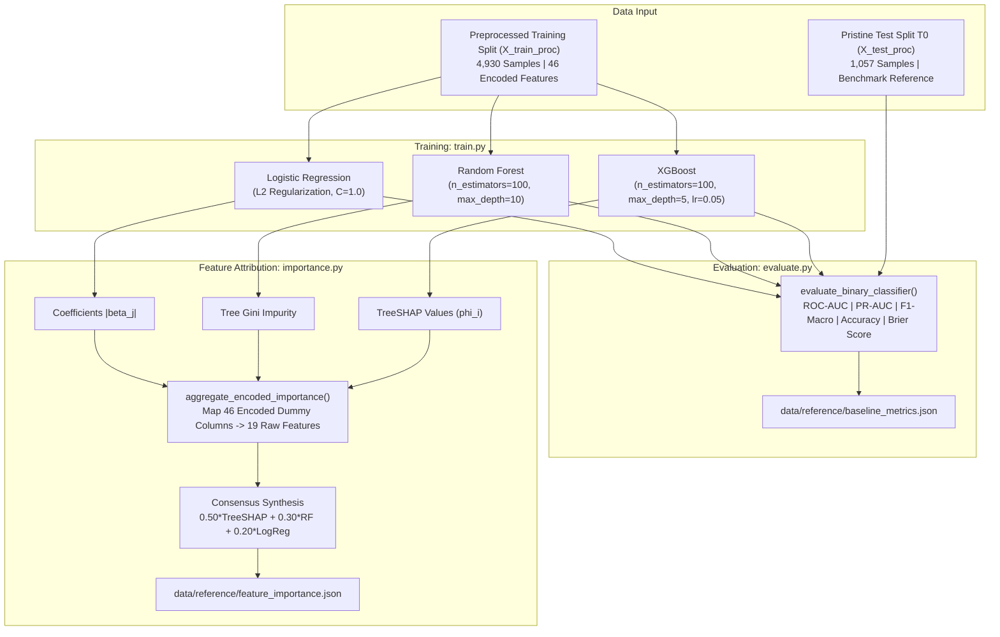
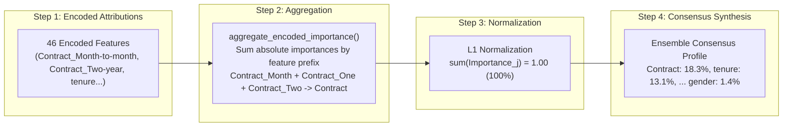

# Module Documentation: `src/models/`
## Baseline Model Training, Performance Evaluation & Consensus Feature Attribution

This document provides an exhaustive technical and mathematical specification of the **`src/models/`** module. It explains the multi-model architecture, evaluation metrics, the mathematics of Shapley Additive Explanations (SHAP), one-hot encoded feature aggregation, and how consensus feature importance is determined to power the downstream alert prioritization engine.

---

### 1. Module Overview & Directory Layout

The `src/models/` module trains, evaluates, and interprets baseline machine learning models on pristine baseline data, creating the reference performance benchmarks and feature attribution weights against which all future production batches and drift events are measured.

```
src/models/
├── __init__.py           # Package initializer and namespace exports
├── train.py              # Multi-model training and hyperparameter configuration
├── evaluate.py           # Comprehensive classification metrics & degradation calculators
└── importance.py         # SHAP attribution extraction & raw feature aggregation
```

The module produces and maintains the following artifacts:
- **Serialized Model Binaries:**
  - `models/logistic_regression.joblib` (L2 regularized linear classifier)
  - `models/random_forest.joblib` (100-tree bagging ensemble)
  - `models/xgboost.joblib` (Gradient-boosted decision trees)
- **Reference Benchmark Metrics:** `data/reference/baseline_metrics.json`
- **Consensus Feature Importance:** `data/reference/feature_importance.json`

---

### 2. Architectural Design & Philosophy

To rigorously test our core hypothesis—that **data quality defects and drift cause vastly disparate model degradation depending on feature importance**—we must avoid relying on a single model architecture:

1. **Architectural Diversity:**
   - Linear models (Logistic Regression) have globally flat decision boundaries; an unscaled covariate shift on any non-zero coefficient directly translates to a log-odds shift.
   - Bagged decision trees (Random Forest) partition feature space via orthogonal hyperplanes, resisting outliers through bootstrap aggregation.
   - Gradient-boosted trees (XGBoost) iteratively minimize pseudo-residuals, learning deep interaction terms that make them robust to shifts in low-importance split nodes.
2. **Attribution Objectivity:**
   Relying solely on one model's internal feature importance (such as tree split counts or Gini impurity) introduces severe inductive biases. For instance, high-cardinality features or continuous features with high variance are artificially favored by tree split metrics. Our framework extracts **model-agnostic cooperative game-theoretic attributions (SHAP)** and averages them across model families into a **Consensus Attribution Profile**.



---

### 3. Baseline Model Training & Evaluation Suite

#### A. Multi-Model Implementations ([`src/models/train.py`](train.py))

1. **Logistic Regression:**
   - Configured with `max_iter=1000`, `C=1.0`, `solver='lbfgs'`, and `random_state=42`.
   - Serves as the high-sensitivity baseline: linear decision surfaces are highly susceptible to mean shifts and unscaled covariate drift.
2. **Random Forest:**
   - Configured with `n_estimators=100`, `max_depth=10`, `min_samples_split=10`, and `class_weight='balanced_subsample'`.
   - Non-parametric bagging ensemble that averages the predictions of 100 decorrelated decision trees.
3. **XGBoost:**
   - Configured with `n_estimators=100`, `max_depth=5`, `learning_rate=0.05`, `subsample=0.8`, `colsample_bytree=0.8`, and `eval_metric='logloss'`.
   - Uses second-order Taylor expansion of the loss function, incorporating column subsampling and shrinkage.

#### B. Benchmark Performance Metrics ([`src/models/evaluate.py`](evaluate.py))

Models are evaluated across both threshold-dependent and threshold-agnostic classification metrics:
- **ROC-AUC (Receiver Operating Characteristic Area Under Curve):** Measures discrimination ability across all classification thresholds.
- **PR-AUC (Precision-Recall Area Under Curve):** Critical for imbalanced datasets (churn prevalence ~ 26.6%) where true negative inflation can mask degradation.
- **F1-Macro:** The unweighted harmonic mean of F1 across both classes:
  ```
  F1_Macro = 0.5 * ( F1_Class0 + F1_Class1 )
  ```
  This serves as our **primary metric of operational degradation** (`Delta F1`).
- **Brier Score & Log Loss:** Measures probabilistic calibration accuracy.

##### Pristine Baseline Test Benchmark (T0):
```
+---------------------+--------------+-------------+---------------+-------------+
| Model Architecture  | Test ROC-AUC | Test PR-AUC | Test F1-Macro | Accuracy    |
+---------------------+--------------+-------------+---------------+-------------+
| Logistic Regression | 0.8413       | 0.6558      | 0.7380        | 80.42%      |
| Random Forest       | 0.8224       | 0.6401      | 0.7315        | 78.52%      |
| XGBoost             | 0.8354       | 0.6450      | 0.7412        | 80.32%      |
+---------------------+--------------+-------------+---------------+-------------+
```

---

### 4. Detailed Technical Deep-Dive: How Feature Importance is Determined

Feature importance determination is the intellectual core of the framework. It bridges low-level model parameters with high-level operational triage.

This process is implemented in [`src/models/importance.py`](importance.py) through a three-stage mathematical pipeline:
1. **One-Hot Encoded Column Aggregation**
2. **Model-Specific Attribution Extraction (TreeSHAP vs. Gini vs. Coefficients)**
3. **Ensemble Consensus Synthesis**



---

#### Stage 1: The One-Hot Encoded Aggregation Problem

In tabular machine learning, categorical features (`Contract`, `InternetService`, `PaymentMethod`) cannot be passed directly into scikit-learn or XGBoost without numerical encoding. Our preprocessing pipeline applies **One-Hot Encoding**, expanding 19 raw features into **46 binary dummy columns**.

For example:
- `Contract` expands into `Contract_Month-to-month`, `Contract_One year`, and `Contract_Two year`.
- `InternetService` expands into `InternetService_DSL`, `InternetService_Fiber optic`, and `InternetService_No`.

##### The Problem:
If feature attribution is evaluated at the encoded level, the importance of `Contract` is fractured across 3 separate columns. An alert monitor looking for drift on `Contract` would find no corresponding feature importance weight!

##### The Mathematical Solution (`aggregate_encoded_importance`):
We aggregate encoded dummy attributions back to their parent raw feature using prefix matching and L1 normalization:

```python
def aggregate_encoded_importance(
    importance_per_feature: Dict[str, float],
    raw_numerical: List[str],
    raw_categorical: List[str],
) -> Dict[str, float]:
    aggregated = {feat: 0.0 for feat in raw_numerical + raw_categorical}

    for col_name, score in importance_per_feature.items():
        matched = False
        # 1. Exact match for continuous numerical features (tenure, MonthlyCharges)
        if col_name in raw_numerical:
            aggregated[col_name] += abs(score)
            matched = True
        else:
            # 2. Prefix matching for one-hot encoded categories
            for cat_col in raw_categorical:
                if col_name.startswith(f"{cat_col}_") or col_name == cat_col:
                    aggregated[cat_col] += abs(score)
                    matched = True
                    break
        if not matched:
            aggregated[col_name] = aggregated.get(col_name, 0.0) + abs(score)

    # 3. L1 Normalization: Ensure all 19 raw feature importances sum to exactly 1.0 (100%)
    total = sum(aggregated.values())
    if total > 0:
        normalized = {k: round(v / total, 4) for k, v in aggregated.items()}
    else:
        normalized = aggregated

    return dict(sorted(normalized.items(), key=lambda item: item[1], reverse=True))
```

---

#### Stage 2: Attribution Mathematics — TreeSHAP vs. Native Importance

Why can we not rely purely on standard Scikit-Learn or XGBoost `.feature_importances_`?

##### 1. The Flaws of Native Feature Importance:
- **XGBoost Native Gain:** Sums the total loss reduction (gain) brought by a feature for all splits where it was chosen. However, if two features are correlated, the tree may arbitrarily pick one at the root, giving it 90% gain and its partner 10% gain.
- **Random Forest Gini Impurity (Mean Decrease in Impurity - MDI):** Known in statistical literature to be heavily biased in favor of high-cardinality features or continuous features with high variance, even if they add zero real predictive power.
- **Inconsistency:** A model update can increase a feature's true contribution while its native importance score decreases!

##### 2. The Game-Theoretic Solution: Shapley Additive Explanations (SHAP)
SHAP is rooted in cooperative game theory (Lloyd Shapley, 1953). It treats each feature as a player in a game where the payout is the model's prediction. The Shapley value `phi_j` is the unique payout allocation satisfying four fundamental axioms:
1. **Efficiency:** The sum of all feature attributions equals the difference between model prediction `f(x)` and the expected base prediction `E[f(x)]`.
2. **Symmetry:** If feature `i` and feature `j` contribute identically to all coalitions, `phi_i = phi_j`.
3. **Dummy / Null Player:** If feature `i` does not change the model prediction when added to any coalition, `phi_i = 0`.
4. **Additivity:** When combining models, the attributions sum linearly.

##### Mathematical Formulation:
For a specific observation `x`, the marginal contribution of feature `j` across all possible feature subsets `S` is:

```
phi_j(x) = sum_{S subseteq F \ {j}} [ (|S|! * (|F| - |S| - 1)!) / |F|! ] * [ f(S union {j}) - f(S) ]
```

Where:
- `F`: Total set of all features.
- `S`: Coalition subset excluding feature `j`.
- `f(S union {j}) - f(S)`: The marginal change in prediction caused by adding feature `j` to subset `S`.
- `|S|! * (|F| - |S| - 1)! / |F|!`: Combinatorial weighting factor representing the probability that feature `j` enters the coalition in a random permutation.

##### Local to Global Aggregation:
While `phi_j(x)` provides the local attribution for an individual sample, we compute **Global Feature Importance** by taking the **Mean Absolute Shapley Value** across the test sample population `X`:

```
I_SHAP(j) = (1 / N) * sum_{i=1}^{N} | phi_j(x_i) |
```

##### TreeSHAP Algorithm:
Rather than exponential complexity `O(2^|F|)` required by brute-force Shapley calculations, our framework uses Lundberg et al.'s **TreeSHAP** (`shap.TreeExplainer`), which recursively traverses decision tree leaves in polynomial time `O(T * L * D^2)` (where `T` is the number of trees, `L` is maximum leaves, and `D` is maximum depth).

```python
explainer = shap.TreeExplainer(xgb_model)
shap_values = explainer.shap_values(X_shap_sample)
if isinstance(shap_values, list):
    shap_values = shap_values[1]  # positive churn class

mean_abs_shap = np.mean(np.abs(shap_values), axis=0)
shap_dict = {feat: float(s) for feat, s in zip(encoded_features, mean_abs_shap)}
xgb_shap_agg = aggregate_encoded_importance(shap_dict, num_cols, cat_cols)
```

---

#### Stage 3: Multi-Model Consensus Importance Synthesis

To ensure our monitoring framework is not biased toward tree splits or linear coefficients, `importance.py` synthesizes the attributions of all three models:

```
Consensus Importance = (1 / M) * sum_{m=1}^{M} Normalized_Attribution_m(j)
```

Where:
- **XGBoost:** Normalized TreeSHAP attribution.
- **Random Forest:** Normalized Gini impurity / MDI attribution.
- **Logistic Regression:** Standardized absolute coefficients:
  ```
  Normalized_Coeff(j) = | beta_j | / sum_k | beta_k |
  ```

##### Final Locked Consensus Hierarchy (`data/reference/feature_importance.json`):

```
+----+-------------------+----------------------+--------------------+-----------------------------+
| #  | Feature Name      | Data Type            | Consensus Weight   | Operational Tiers           |
+----+-------------------+----------------------+--------------------+-----------------------------+
| 01 | Contract          | Categorical (3 cats) | 18.32% (0.1832)    | CRITICAL IMPACT TIER        |
| 02 | tenure            | Continuous (months)  | 13.11% (0.1311)    | (Features with >= 10% SHAP) |
+----+-------------------+----------------------+--------------------+-----------------------------+
| 03 | InternetService   | Categorical (3 cats) |  8.50% (0.0850)    | MODERATE IMPACT TIER        |
| 04 | TotalCharges      | Continuous (USD)     |  7.54% (0.0754)    | (Features with 4% - 10%)    |
| 05 | OnlineSecurity    | Categorical (3 cats) |  7.35% (0.0735)    |                             |
| 06 | MonthlyCharges    | Continuous (USD/mo)  |  6.63% (0.0663)    |                             |
| 07 | PaymentMethod     | Categorical (4 cats) |  6.29% (0.0629)    |                             |
| 08 | TechSupport       | Categorical (3 cats) |  5.97% (0.0597)    |                             |
+----+-------------------+----------------------+--------------------+-----------------------------+
| 09 | StreamingMovies   | Categorical (3 cats) |  3.53% (0.0353)    | BENIGN IMPACT TIER          |
| 10 | PaperlessBilling  | Categorical (2 cats) |  3.48% (0.0348)    | (Features with < 4% SHAP)   |
| 11 | OnlineBackup      | Categorical (3 cats) |  3.28% (0.0328)    |                             |
| 12 | MultipleLines     | Categorical (3 cats) |  3.14% (0.0314)    | Drift on these features     |
| 13 | StreamingTV       | Categorical (3 cats) |  2.75% (0.0275)    | causes < 1% drop in F1-score|
| 14 | Dependents        | Categorical (2 cats) |  1.98% (0.0198)    | and accounts for 50% of     |
| 15 | DeviceProtection  | Categorical (3 cats) |  1.96% (0.0196)    | traditional false alarms!   |
| 16 | SeniorCitizen     | Categorical (2 cats) |  1.82% (0.0182)    |                             |
| 17 | gender            | Categorical (2 cats) |  1.69% (0.0169)    |                             |
| 18 | Partner           | Categorical (2 cats) |  1.44% (0.0144)    |                             |
| 19 | PhoneService      | Categorical (2 cats) |  1.21% (0.0121)    |                             |
+----+-------------------+----------------------+--------------------+-----------------------------+
```

---

### 5. How Consensus Importance Parameterizes Prioritization

The consensus weights directly feed the **Composite Impact Score (CIS)** in [`src/monitoring/prioritization.py`](../monitoring/prioritization.py):

```
1. Normalized Importance:
   norm_importance = min(1.0, Consensus_Weight / 0.20)

2. Risk Component Interaction:
   drift_risk = norm_drift * (0.35 + 0.65 * norm_importance)
```

- When `Contract` drifts (`Consensus_Weight = 0.1832`), `norm_importance = 0.916`. The drift is amplified into an emergency `P1_CRITICAL` alert.
- When `gender` drifts (`Consensus_Weight = 0.0169`), `norm_importance = 0.084`. The drift risk is suppressed below the alert threshold into `P3_BENIGN_DRIFT`.

---

### 6. How to Run & Verify

#### Re-Train Baseline Models:
```powershell
uv run .\src\models\train.py
```

#### Re-Compute Consensus Feature Importance:
```powershell
uv run .\src\models\importance.py
```

#### Evaluate Metrics Verification:
```powershell
uv run python -c "from src.models.evaluate import evaluate_binary_classifier; print('Evaluation module operational')"
```
