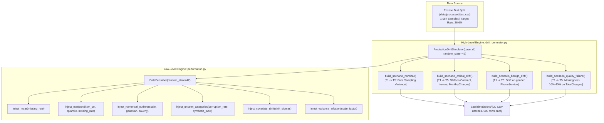

# Module Documentation: `src/simulation/`
## Controlled Data Quality Perturbation & Production Drift Simulator

This document provides an exhaustive technical and mathematical specification of the **`src/simulation/`** module. It explains the design philosophy, mathematical equations, code implementations, parameter configurations, and temporal batch mechanics governing the synthesis of production operational scenarios.

---

### 1. Module Overview & Directory Layout

The simulation module is responsible for bridging the gap between static historical datasets and dynamic production environments. Because live production data with labeled ground truth and controlled drift is rarely accessible in research settings, this module implements a **parameter-controlled stochastic synthesis engine**.

```
src/simulation/
├── __init__.py               # Package initializer and namespace exports
├── perturbation.py           # Core mutator engine (DataPerturber class)
└── drift_generator.py        # Scenario synthesizer (ProductionDriftSimulator class)
```

The outputs of this module populate the physical data store:

```
data/simulations/
├── nominal/                  # Scenario A: Clean production baseline (Batches T1 - T5)
├── critical_drift/           # Scenario B: High drift on high-importance features (Batches T1 - T5)
├── benign_drift/             # Scenario C: High drift on low-importance features (Batches T1 - T5)
└── quality_failure/          # Scenario D: Missingness surge & outlier explosion (Batches T1 - T5)
```

---

### 2. Architectural Design & Philosophy

Traditional MLOps benchmarking often applies uniform Gaussian noise across all features simultaneously. While simple, this approach fails to mimic real-world production dynamics:
1. **Defect Heterogeneity:** Production failures occur across two orthogonal axes:
   - **Data Quality Anomalies:** Syntactic defects caused by upstream software bugs (missing fields, database schema changes, serialization glitches, extreme outliers).
   - **Distributional Drift:** Semantic shifts caused by real-world consumer behavior changes (covariate shift, economic trends, policy updates).
2. **Feature Asymmetry:** Tabular models do not value features equally. A $2\sigma$ shift in a feature with $18\%$ SHAP importance destroys the model's decision boundary, whereas the exact same $2\sigma$ shift in a feature with $1\%$ importance is completely harmless.
3. **Temporal Progression:** Drift is not instantaneous. Models typically face gradual shifts across successive production cycles ($T_1 \dots T_N$).

To model these phenomena with mathematical precision, the simulation framework decouples low-level atomic mutations ([`perturbation.py`](file:///c:/Josh/practice/data_analytics/src/simulation/perturbation.py)) from high-level multi-batch operational scenarios ([`drift_generator.py`](file:///c:/Josh/practice/data_analytics/src/simulation/drift_generator.py)).



---

### 3. Detailed Technical Deep-Dive: `src/simulation/perturbation.py`

The `DataPerturber` class operates as a stateless (or isolated stateful RNG) transformer. Every method accepts a Pandas DataFrame, creates a defensive deep copy, applies mathematical transformations to targeted subsets, and returns the perturbed DataFrame without side effects.

#### A. State Isolation & Reproducibility
```python
def __init__(self, random_state: int = 42):
    self.random_state = random_state
    self.rng = np.random.RandomState(random_state)
```
*Design Decision:* By instantiating an internal `np.random.RandomState(random_state)` rather than relying on global `np.random.seed()`, we guarantee deterministic, reproducible mutations across threads and runs without leaking state into other modules or Jupyter sessions.

---

#### B. Atomic Mutation 1: Missing Completely At Random (`inject_mcar`)

##### Mathematical Formulation:
In Little & Rubin's missing data taxonomy, Missing Completely at Random (MCAR) implies that the probability of an observation being missing is completely independent of both observed variables $\mathbf{x}_{\text{obs}}$ and unobserved variables $\mathbf{x}_{\text{mis}}$, as well as the target $y$:

$$P(M_{ij} = 1 \mid \mathbf{x}_i, y_i) = P(M_{ij} = 1) = \alpha$$

where $M_{ij} \in \{0, 1\}$ is a missingness indicator:

$$x_{ij} \leftarrow \begin{cases} \text{NaN}, & \text{if } U_{ij} < \alpha \\ x_{ij}, & \text{if } U_{ij} \ge \alpha \end{cases}, \quad U_{ij} \sim \text{Uniform}(0, 1)$$

##### Code Implementation:
```python
def inject_mcar(
    self,
    df: pd.DataFrame,
    columns: List[str],
    missing_rate: float,
) -> pd.DataFrame:
    corrupted = df.copy()
    n_rows = len(corrupted)

    for col in columns:
        if col not in corrupted.columns:
            continue
        mask = self.rng.rand(n_rows) < missing_rate
        corrupted.loc[mask, col] = np.nan

    return corrupted
```

##### Operational Purpose:
Simulates upstream network dropouts, telemetry packet loss, or database extraction failures where fields are lost at random across rows.

---

#### C. Atomic Mutation 2: Missing At Random (`inject_mar`)

##### Mathematical Formulation:
Missing at Random (MAR) implies that missingness in a target feature $X_j$ is conditionally dependent on the observed values of another predictor $X_k$, but independent of the missing values themselves:

$$P(M_{ij} = 1 \mid X_{ik}, X_{ij}) = P(M_{ij} = 1 \mid X_{ik})$$

Our implementation defines a threshold-based conditional missingness mechanism based on the empirical $\theta$-quantile of the conditioning column $X_k$:

$$q_\theta = \text{Quantile}(X_k, \theta)$$

$$P(M_{ij} = 1 \mid X_{ik}) = \begin{cases} \alpha_{\text{cond}}, & \text{if } X_{ik} \ge q_\theta \\ 0.0, & \text{if } X_{ik} < q_\theta \end{cases}$$

##### Code Implementation:
```python
def inject_mar(
    self,
    df: pd.DataFrame,
    target_col: str,
    condition_col: str,
    condition_quantile: float = 0.5,
    missing_rate: float = 0.3,
) -> pd.DataFrame:
    corrupted = df.copy()
    if target_col not in corrupted.columns or condition_col not in corrupted.columns:
        return corrupted

    threshold = corrupted[condition_col].quantile(condition_quantile)
    eligible_mask = corrupted[condition_col] >= threshold
    random_submask = self.rng.rand(len(corrupted)) < missing_rate

    final_mask = eligible_mask & random_submask
    corrupted.loc[final_mask, target_col] = np.nan
    return corrupted
```

##### Operational Purpose:
Simulates structural business omissions. For example, high-spending enterprise customers (`MonthlyCharges` $> 50\text{th percentile}$) frequently use consolidated billing portals, leading to missing historical ledger values in `TotalCharges`.

---

#### D. Atomic Mutation 3: Numerical Outlier Contamination (`inject_numerical_outliers`)

##### Mathematical Formulation:
For a continuous feature $X_j$ with empirical mean $\mu_j$ and sample standard deviation $\sigma_j$:

$$\sigma_j = \sqrt{\frac{1}{N-1} \sum_{i=1}^{N} (x_{ij} - \bar{x}_j)^2}$$

A subset of rows $\mathcal{I}_{\text{out}}$ with size $|\mathcal{I}_{\text{out}}| = \lfloor \delta \cdot N \rfloor$ is selected uniformly at random. Outliers are injected according to one of three distinct contamination modes:

1. **Scale Multiplier (`mode="scale_multiplier"`):**
   Scales extreme values by a constant factor $\gamma \ge 2.0$:
   $$x_{ij}' = x_{ij} \cdot \gamma, \quad i \in \mathcal{I}_{\text{out}}$$
   *Effect:* Models currency unit errors (e.g., entering dollar amounts in cents, multiplying values by $100\times$).

2. **Additive Gaussian Shift (`mode="gaussian_noise"`):**
   Adds a heavy shift drawn from a normal distribution centered at $k$ standard deviations away:
   $$x_{ij}' = x_{ij} + \mathcal{N}\left(k \cdot \sigma_j, \ \sigma_j^2\right), \quad i \in \mathcal{I}_{\text{out}}$$
   *Effect:* Injects severe sensor drift or calibration offsets.

3. **Cauchy Heavy-Tailed Noise (`mode="cauchy_noise"`):**
   The standard Cauchy distribution has probability density function:
   $$f(z) = \frac{1}{\pi (1 + z^2)}$$
   Because its theoretical mean and variance are undefined, it produces rare, astronomically large extreme values that break linear standardizers:
   $$x_{ij}' = x_{ij} + \gamma \cdot \sigma_j \cdot Z_i, \quad Z_i \sim \text{StandardCauchy}, \quad i \in \mathcal{I}_{\text{out}}$$

##### Code Implementation:
```python
def inject_numerical_outliers(
    self,
    df: pd.DataFrame,
    columns: List[str],
    mode: str = "scale_multiplier",
    intensity: float = 3.0,
    fraction: float = 0.10,
) -> pd.DataFrame:
    corrupted = df.copy()
    n_rows = len(corrupted)

    for col in columns:
        if col not in corrupted.columns:
            continue
        series = pd.to_numeric(corrupted[col], errors="coerce")
        std = float(series.std()) if series.std() > 0 else 1.0
        mean = float(series.mean())

        mask = self.rng.rand(n_rows) < fraction
        num_outliers = int(mask.sum())
        if num_outliers == 0:
            continue

        if mode == "scale_multiplier":
            corrupted.loc[mask, col] = series.loc[mask] * intensity
        elif mode == "gaussian_noise":
            noise = self.rng.normal(loc=intensity * std, scale=std, size=num_outliers)
            corrupted.loc[mask, col] = series.loc[mask] + noise
        elif mode == "cauchy_noise":
            noise = self.rng.standard_cauchy(size=num_outliers) * (intensity * std)
            corrupted.loc[mask, col] = series.loc[mask] + noise

    return corrupted
```

---

#### E. Atomic Mutation 4: Categorical Level Corruption (`inject_unseen_categories`)

##### Mathematical Formulation:
Given a categorical feature $C_k$ with reference domain support:

$$\mathcal{C}_{\text{ref}} = \{c_1, c_2, \dots, c_K\}$$

A random Bernoulli mask with corruption probability $\beta \in (0, 1)$ substitutes existing valid tokens with an out-of-vocabulary (OOV) synthetic token $c^* \notin \mathcal{C}_{\text{ref}}$:

$$c_{ik}' = \begin{cases} c^* = \text{'NOVEL\_CATEGORY\_X'}, & \text{if } U_i < \beta \\ c_{ik}, & \text{if } U_i \ge \beta \end{cases}, \quad U_i \sim \text{Uniform}(0, 1)$$

##### Code Implementation:
```python
def inject_unseen_categories(
    self,
    df: pd.DataFrame,
    columns: List[str],
    corruption_rate: float = 0.15,
    synthetic_label: str = "NOVEL_CATEGORY_X",
) -> pd.DataFrame:
    corrupted = df.copy()
    n_rows = len(corrupted)

    for col in columns:
        if col not in corrupted.columns:
            continue
        mask = self.rng.rand(n_rows) < corruption_rate
        corrupted.loc[mask, col] = synthetic_label

    return corrupted
```

##### Operational Purpose:
Tests whether one-hot encoders crash in production or properly route novel inputs to zero-vectors via `handle_unknown="ignore"`, and measures how decision trees handle missing branch routes.

---

#### F. Atomic Mutation 5: Sudden Covariate Mean Shift (`inject_covariate_shift`)

##### Mathematical Formulation:
Shifts the empirical mean of a continuous feature by $k$ standard deviations across the entire batch while leaving variance and higher-order moments invariant:

$$x_{ij}' = x_{ij} + k \cdot \sigma_j, \quad \forall i \in \{1, \dots, N\}$$

$$\mathbb{E}[X_j'] = \mathbb{E}[X_j] + k \cdot \sigma_j = \mu_j + k \cdot \sigma_j$$

$$\text{Var}(X_j') = \text{Var}(X_j + k \sigma_j) = \text{Var}(X_j) = \sigma_j^2$$

$$\text{Skew}(X_j') = \text{Skew}(X_j), \quad \text{Kurt}(X_j') = \text{Kurt}(X_j)$$

##### Code Implementation:
```python
def inject_covariate_shift(
    self,
    df: pd.DataFrame,
    columns: List[str],
    shift_sigmas: float = 1.5,
) -> pd.DataFrame:
    corrupted = df.copy()
    for col in columns:
        if col not in corrupted.columns:
            continue
        series = pd.to_numeric(corrupted[col], errors="coerce")
        std = float(series.std()) if series.std() > 0 else 1.0
        shift_amount = shift_sigmas * std
        corrupted[col] = series + shift_amount
    return corrupted
```

---

#### G. Atomic Mutation 6: Variance / Scale Inflation (`inject_variance_inflation`)

##### Mathematical Formulation:
Scales the spread of continuous feature $X_j$ around its empirical mean $\mu_j$ by an inflation factor $\tau > 1.0$:

$$x_{ij}' = \mu_j + \tau \cdot (x_{ij} - \mu_j), \quad \forall i \in \{1, \dots, N\}$$

$$\mathbb{E}[X_j'] = \mu_j + \tau \cdot (\mathbb{E}[X_j] - \mu_j) = \mu_j$$

$$\text{Var}(X_j') = \text{Var}(\tau \cdot (X_j - \mu_j)) = \tau^2 \cdot \text{Var}(X_j) = \tau^2 \cdot \sigma_j^2$$

$$\text{Std}(X_j') = \tau \cdot \sigma_j$$

##### Code Implementation:
```python
def inject_variance_inflation(
    self,
    df: pd.DataFrame,
    columns: List[str],
    scale_factor: float = 2.0,
) -> pd.DataFrame:
    corrupted = df.copy()
    for col in columns:
        if col not in corrupted.columns:
            continue
        series = pd.to_numeric(corrupted[col], errors="coerce")
        mean = float(series.mean())
        corrupted[col] = mean + (series - mean) * scale_factor
    return corrupted
```

---

### 4. Detailed Technical Deep-Dive: `src/simulation/drift_generator.py`

The `ProductionDriftSimulator` class orchestrates the atomic mutators into multi-batch temporal production streams.

#### A. Temporal Bootstrapping Engine
To model independent weekly or monthly production batches arriving from the real world, the simulator bootstraps $M = 5$ batches of size $N_{\text{batch}} = 500$ from the pristine test pool:

```python
def generate_batches(self, num_batches: int = 5, batch_size: int = 500) -> List[pd.DataFrame]:
    batches = []
    for b_idx in range(num_batches):
        sample = self.base_df.sample(
            n=min(batch_size, len(self.base_df)),
            replace=True,
            random_state=self.random_state + b_idx * 17,
        ).reset_index(drop=True)
        batches.append(sample)
    return batches
```

*Mathematical Rigor:* Setting the seed progression to `random_state + b_idx * 17` guarantees:
1. Each temporal batch draws a distinct, non-identical subset of the test pool.
2. Across different operational scenarios (Nominal, Critical, Benign), batch $t$ shares the exact same base instances before corruption, ensuring that performance differences are caused **strictly by the injected mutations**, not baseline sampling variance.

---

### 5. Detailed Breakdown of the 4 Operational Scenarios

```mermaid
gantt
    title Production Scenario Timeline Progression (T1 to T5)
    dateFormat X
    axisFormat %s

    section Scenario A: Nominal
    T1: Clean Sampling :0, 1
    T2: Clean Sampling :1, 2
    T3: Clean Sampling :2, 3
    T4: Clean Sampling :3, 4
    T5: Clean Sampling :4, 5

    section Scenario B: Critical Drift
    T1: Clean Base :0, 1
    T2: Shift 0.7 sigma (tenure, MonthlyCharges) :1, 2
    T3: Shift 1.4 sigma + 10% New Contracts :2, 3
    T4: Shift 2.1 sigma + 20% New Contracts :3, 4
    T5: Shift 2.8 sigma + 30% New Contracts :4, 5

    section Scenario C: Benign Drift
    T1: Clean Base :0, 1
    T2: 30% New Categories (gender, PhoneService) :1, 2
    T3: 40% New Categories (gender, PhoneService) :2, 3
    T4: 50% New Categories (gender, PhoneService) :3, 4
    T5: 60% New Categories (gender, PhoneService) :4, 5

    section Scenario D: Quality Failure
    T1: Clean Base :0, 1
    T2: 10% MCAR Missingness :1, 2
    T3: 20% MCAR + 5x Outliers (TotalCharges) :2, 3
    T4: 30% MCAR + 5x Outliers (TotalCharges) :3, 4
    T5: 40% MCAR + 5x Outliers (TotalCharges) :4, 5
```

---

#### Scenario A: Nominal Operations (`build_scenario_nominal`)
* **Target Features:** None.
* **Corruptions:** None.
* **Batch Breakdown:**
  - `Batch_T1_Nominal` through `Batch_T5_Nominal`: Clean bootstrapped records representing standard statistical fluctuations in production.
* **Expected Metrics:**
  - $\text{PSI} < 0.10$ across all features.
  - Downstream Macro-$F_1$ change: $|\Delta F_1| < 0.01$.
  - Triage Result: **P4_NOMINAL** (Nominal state; routine logging).

---

#### Scenario B: Critical Drift on High-Importance Features (`build_scenario_critical_drift`)
* **Target Features:** `Contract` (Rank #1, 18.3%), `tenure` (Rank #2, 13.1%), `MonthlyCharges` (Rank #6, 6.6%).
* **Combined Model Attribution:** **$38.06\%$** of total decision weight.
* **Batch Progression:**
  - **Batch $T_1$:** Pristine baseline sample.
  - **Batch $T_2$ ($i = 1$):** Covariate mean shift of $+0.7\sigma$ on `tenure` and `MonthlyCharges`.
  - **Batch $T_3$ ($i = 2$):** Covariate shift reaches $+1.4\sigma$. Unseen category injection begins on `Contract`: $10\%$ of rows replaced with `'NEW_FLEX_PLAN'`.
  - **Batch $T_4$ ($i = 3$):** Covariate shift reaches $+2.1\sigma$. `Contract` unseen category rate reaches $20\%$.
  - **Batch $T_5$ ($i = 4$):** Covariate shift reaches $+2.8\sigma$. `Contract` unseen category rate reaches $30\%$.
* **Downstream Model Impact:**
  - Massive decision boundary distortion.
  - Macro-$F_1$ drops from $0.7017 \to 0.5804$ ($\Delta F_1 \approx 0.1213$, a **$17.3\%$ collapse**).
  - Triage Result: **P1_CRITICAL** (Emergency Alert: Fallback / Retrain).

---

#### Scenario C: Benign Drift on Negligible-Importance Features (`build_scenario_benign_drift`)
* **Target Features:** `gender` (Rank #18, 1.4%), `PhoneService` (Rank #19, 1.1%).
* **Combined Model Attribution:** **$< 2.5\%$** of total decision weight.
* **Batch Progression:**
  - **Batch $T_1$:** Pristine baseline sample.
  - **Batch $T_2$ ($i = 1$):** $30\%$ of rows in `gender` and `PhoneService` corrupted with novel token `'NON_BINARY_OTHER'`.
  - **Batch $T_3$ ($i = 2$):** Corruption rate reaches $40\%$.
  - **Batch $T_4$ ($i = 3$):** Corruption rate reaches $50\%$.
  - **Batch $T_5$ ($i = 4$):** Corruption rate reaches $60\%$.
* **Downstream Model Impact:**
  - Statistical tests trigger high alarms: Categorical $\text{PSI} > 0.45$, $\chi^2 > 50.0$, $p < 10^{-6}$.
  - Yet downstream model performance is virtually unaffected: $|\Delta F_1| \le 0.005$ ($< 0.5\%$).
* **Research Core Value:**
  - This scenario provides the empirical evidence proving **RQ2 and RQ3**.
  - Traditional statistical tools trigger immediate critical alerts here.
  - Our framework computes a low Composite Impact Score (CIS) and assigns **P3_BENIGN_DRIFT**, automatically setting `suppressed_false_alarm = True`.

---

#### Scenario D: Data Quality Pipeline Failure (`build_scenario_quality_failure`)
* **Target Features:** `TotalCharges` (Rank #4, 7.5%), `tenure` (Rank #2, 13.1%), `MonthlyCharges` (Rank #6, 6.6%).
* **Batch Progression:**
  - **Batch $T_1$:** Pristine baseline sample.
  - **Batch $T_2$ ($i = 1$):** $10\%$ MCAR missingness injected into `TotalCharges`, `tenure`, `MonthlyCharges`.
  - **Batch $T_3$ ($i = 2$):** Missingness escalates to $20\%$. In addition, $15\%$ of `TotalCharges` observations are multiplied by $5.0\times$ (severe outlier contamination).
  - **Batch $T_4$ ($i = 3$):** Missingness escalates to $30\%$; $15\%$ outlier contamination continues.
  - **Batch $T_5$ ($i = 4$):** Missingness escalates to $40\%$; $15\%$ outlier contamination continues.
* **Downstream Model Impact:**
  - Preprocessing imputer fills missing entries with median, diluting predictive signal.
  - Outliers distort linear model predictions while moderately affecting tree splits.
  - Performance drops moderately: $\Delta F_1 \approx 0.03 - 0.06$.
  - Triage Result: **P2_QUALITY_ALERT** (Pipeline Investigation: Inspect upstream ETL).

---

### 6. Batch Generation & Disk Serialization

The entrypoint function `generate_and_save_all_scenarios()` coordinates generation and disk persistence:

```python
def generate_and_save_all_scenarios():
    root = get_project_root()
    test_path = root / "data" / "processed" / "test.csv"
    test_df = pd.read_csv(test_path)

    simulator = ProductionDriftSimulator(test_df)
    scenarios_dir = root / "data" / "simulations"
    scenarios_dir.mkdir(parents=True, exist_ok=True)

    all_scenarios = {
        "nominal": simulator.build_scenario_nominal(),
        "critical_drift": simulator.build_scenario_critical_drift(),
        "benign_drift": simulator.build_scenario_benign_drift(),
        "quality_failure": simulator.build_scenario_quality_failure(),
    }
    # Persists 20 total CSV files...
```

To regenerate the 20 batch datasets from the command line:

```bash
uv run .\src\simulation\drift_generator.py
```

Expected output:
```
============================================================
GENERATING PRODUCTION SIMULATION SCENARIO BATCHES
============================================================

Scenario: NOMINAL
  -> Saved Batch_T1_Nominal ((500, 20)) to Batch_T1_Nominal.csv ... Batch_T5_Nominal.csv
Scenario: CRITICAL_DRIFT
  -> Saved Batch_T1_CriticalDrift ((500, 20)) to Batch_T1_CriticalDrift.csv ... Batch_T5_CriticalDrift.csv
Scenario: BENIGN_DRIFT
  -> Saved Batch_T1_BenignDrift ((500, 20)) to Batch_T1_BenignDrift.csv ... Batch_T5_BenignDrift.csv
Scenario: QUALITY_FAILURE
  -> Saved Batch_T1_QualityFailure ((500, 20)) to Batch_T1_QualityFailure.csv ... Batch_T5_QualityFailure.csv

[Simulator] All scenario batches generated in: C:\Josh\practice\data_analytics\data\simulations
```

---

### 7. Unit Testing & Mathematical Verification

The simulation module is covered by rigorous unit tests in [`tests/test_perturbation.py`](file:///c:/Josh/practice/data_analytics/tests/test_perturbation.py):

1. **MCAR Missingness Rate Test:**
   - Validates that requested missingness rate $\alpha = 0.20$ achieves an empirical missingness rate in $[0.17, 0.23]$ on $N=1000$ samples, with zero leakage to non-targeted features.
2. **Covariate Shift Accuracy Test:**
   - Validates that a requested shift of $k = 1.5\sigma$ shifts the empirical mean by $|(\bar{x}_{\text{new}} - \bar{x}_{\text{orig}}) - 1.5\sigma| < 0.10$.

Run tests via:
```bash
uv run pytest -v tests/test_perturbation.py
```
